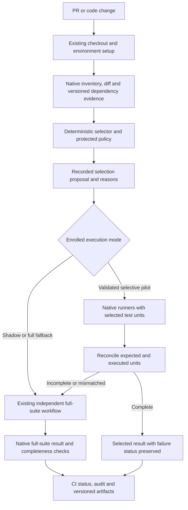
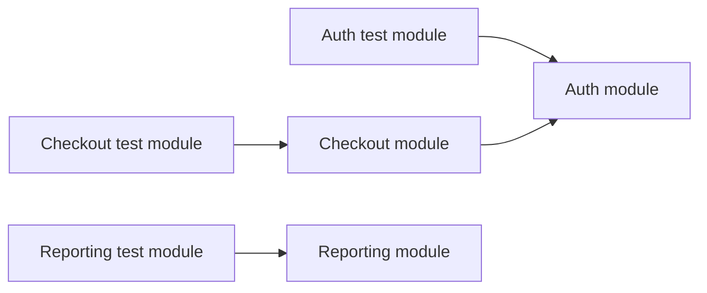

# Smart CI: implementation and deployment plan

Updated: 26 November 2026

Status: Phases 1–5 have local implementations. The packaging PR's Smart CI job completed a live full-fallback run and reconciled 62,423 passing cases; the overall workflow failed in other jobs. Packaging selective execution and trusted baseline reuse remain unverified. The OnRecord TypeScript/Vitest pilot passed live GitHub PRs #29 (103 files / 440 cases, full fallback) and #30 (64 files / 280 cases, actual subset without fallback), with on-demand map rebuilding. Both remain unmerged; broader correctness and performance evaluation remain outstanding. No AWS resources. A separately approved bounded live investigation has now made three paid generation calls; see its evidence below.

Current priority: generalize native enrollment/map lifecycle and evaluate representative caching without weakening the verified selection rules. Abseil PR #10 now demonstrates whole-workflow savings against a matching standalone native baseline: 655 seconds native versus 544 seconds Smart CI from the actual PR event to completed workflow (111 seconds / 16.9% faster). It selected 2/252 test targets and retained all 324 build-only targets; Bazel actions fell from 2,988 to 1,092. Earlier paired localized runs measured 1,061/315 seconds and 619/324 seconds from workflow trigger to job completion, with identical plans. These are repeated measurements of one historical source fix, not independent new scenarios.

Safety and negative evidence are retained: PR #7 detects the same two compilation failures as full native execution; PR #8 verifies full fallback after a header/build-definition change; PR #11 repeats that fallback successfully in the actual one-job policy. Broad shared-hash PR #9 selects 251/252 targets and is slower (640 seconds native versus 924 seconds candidate), with only seven fewer actions. Do not generalize the localized benefit to broad changes. Hosted checks passed 644 tests plus formatting, lint, types and build on the selective tool pin. Native enrollment and artifact references are still pilot-specific, native maps are not automatically refreshed, and warm-cache benefit remains unmeasured. The full product goal remains open.

The agent uses the regular OpenAI Responses API, not Codex authentication; its first hosted trial added zero edges and preserved full fallback. Textual remains a negative compatibility case. Preserve the active goal: automatic deterministic PR selection with demonstrated GitHub time and resource savings. The earlier OnRecord/date-fns/Textual work is evidence, not completion. Shadow runs remain evaluation tools, not permanent product behavior.

Native lifecycle work has started with reusable `smartci bazel pack` and `smartci
bazel plan` commands. They validate full native event completeness, root wildcard
scope, repository/profile identity, bounded artifact hashes and exact Git trees;
they retain full fallback for invalid maps and reject unverified execution
checkouts. The old standalone harness remains compatible. The new CLI's first
[hosted replay](https://github.com/SharmaKunal14/smart-ci/actions/runs/45561199771)
passed against four existing real-PR captures, including deterministic repetition,
exact test/build configuration identities and tampered-evidence fallback. This is
not a new execution benchmark or completion of automatic collection/refresh. The
[bundle handoff](docs/onboarding/bazel-bundles.md) separates implemented contracts
from the remaining trusted collector, artifact lifecycle and runner integration.

The next step adds `smartci bazel collect`: execute reviewed native full-suite and
query commands, validate their evidence, then publish a map bound to the revision
and command configuration. A compatible authenticated bundle avoids both commands;
missing, stale or tampered evidence triggers rebuilding. [Smart CI PR #17](https://github.com/SharmaKunal14/smart-ci/pull/17)
has [727 passing hosted safety tests and successful builds](https://github.com/SharmaKunal14/smart-ci/actions/runs/45751951089).
Fresh enrollment on [Abseil PR #12](https://github.com/SharmaKunal14/abseil-cpp/pull/12)
has **not executed**. Earlier dispatch requests returned HTTP 422, “Actions has been
disabled for this repository,” despite enabled settings. Later inspection found
two setup mistakes: a GitHub-reported merge conflict, now cleared, and a checkout
inherited from the deliberately broken regression fixture. The head now matches
the passing native baseline's application/test/build inputs. A bounded publisher
push replaces the PR/manual trigger, but has not yet produced a run. No new native
outcome, onboarding cost or savings measurement exists for this collector. Artifact
acquisition/publication, automatic PR integration and representative warm-cache
comparisons remain required; keep the full goal active.

The next transport increment adds `smartci bazel fetch`: discover successful
approved publishers at an exact revision, authenticate workflow/run/artifact
origin, validate the native bundle and command configuration, and emit an audited
receipt without hard-coded run IDs. Untrusted/missing evidence remains a cache
miss requiring collection or full execution. PR-produced maps cannot become
trusted publishers. Its bounded API/ZIP checks are covered by controlled tests;
successful fresh native publication/download and complete PR integration still
need hosted verification after Abseil Actions is restored. No new performance
result is claimed. See [artifact onboarding](docs/onboarding/bazel-artifacts.md).

### Active goal completion gates

The active goal is broader than any single prototype. Keep it active until all of
the following are verified; a green safety suite or a smaller candidate list is
insufficient:

1. A real existing repository is enrolled automatically, with native commands,
   configurations and supported boundaries recorded. PR creation and updates
   produce revision-bound, deterministic plans without handwritten dependency
   maps or per-PR test choices. Unsupported changes retain independent full runs.
2. Real GitHub PRs cover an ordinary localized change, a historical regression,
   a shared dependency change and a required full-fallback case. Compare native
   and selected outcomes on the same revisions; retain native failures and
   account for every selected target. Use both old and new dependency evidence
   or a verified invariant establishing that their declarations cannot differ.
3. Measure **X = native trigger-to-result time** and **Y = Smart CI
   trigger-to-result time**, including setup, planning, downloads, tests and
   uploads. Demonstrate Y < X on repeated eligible comparisons, not just shorter
   test subprocesses. Record runner-seconds and onboarding/cache costs separately.
   Preserve native caching, workers, coverage and test configuration. Report cold
   and warm behavior where the native build system already avoids unchanged work.
4. Compare import analysis, runtime-assisted evidence and native build graphs
   from actual hosted evidence. Do not equate fewer diagnostics with completeness
   or select a favorable timing retry. A supported adapter does not establish
   support for arbitrary repositories or languages.
5. Deliver and verify the bounded adaptive investigation workflow described below:
   choose tools based on observations, retain evidence and enforce authority
   outside the agent. Selection remains deterministic; an agent cannot remove
   required tests, waive gaps or promote its confidence to completeness evidence.
   The existing fixture provider is not a live agent. A separate bounded live
   evaluation now has a US$5 ceiling, at most 24 calls and six investigations.
   Admission controls and public-source routing must pass verification first.

No merges or AWS deployment are authorized. Paid calls are authorized only within
the separately approved ceiling and verified controls, not by this goal alone.
Agentic investigation is a goal requirement, while cloud hosting remains optional.
The older sections that defer agents describe implementation order, not permission
to mark this new goal complete without its agentic component.

The native-build-graph work begins with Abseil's unmodified GCC/Bazel C++17
fastbuild profile on a fresh GitHub runner. Its public pinned image is large and
may dominate setup; the upstream optional private remote cache is unavailable.
This is one documented native profile, not the entire upstream matrix. Establish
the native baseline before claiming selection support or savings. The first
graph parser retains declared, generated, implicit and build-only relationships;
it does not yet authorize execution. Native target reconciliation, configuration
binding, source-change eligibility, fallback and actual PR execution remain gates.
The first [native GitHub run](https://github.com/SharmaKunal14/abseil-cpp/actions/runs/45038161080)
failed native timing assertions and timed out with 60 test-target outcomes missing.
It is not an accepted baseline. Preserve this negative result; diagnose the native
environment before spending more runs or comparing selective execution. See
[`native-build-graphs.md`](docs/onboarding/native-build-graphs.md) for the artifact
summary and the evidence required to resume that comparison. A systemd-only crash
policy also failed with 413 observed Apport helpers and 81 OOM kills. The subsequent
[full run](https://github.com/SharmaKunal14/abseil-cpp/actions/runs/45073921737)
verified and temporarily masked the separate Apport hook: all 252 tests and 576
build target/configuration results passed in **932 seconds trigger-to-completion**,
with no observed Apport helpers or OOM kills. Both runner settings were restored.
This is one cold native baseline, not selection savings. Use that identical runner
policy in both benchmark arms, preserve all 324 native build-only targets
(including six cc_test rules not executed by native policy), and reconcile actual
Bazel graph output before enabling any omissions. Retain all failed attempts.

The [Textual scoped-runtime follow-up](docs/onboarding/runtime-scoped-observation.md)
preserved all 3,467 case outcomes on a real PR: 350s native versus 570s instrumented
feedback, with zero omissions. Fixture/collection attribution improved, but parser
execution on other threads and shared file-open attempts still require broad
handling. That runtime experiment left all 14 static gaps unresolved. Before another full-suite probe,
classify the shared phases and preserve any independent reporting/build work;
do not equate a scope label with exclusive dependency ownership.

The subsequent [readonly-hook discovery audit](docs/onboarding/python-attribute-hooks.md)
verified one supported static rejection pattern on Textual PR #8. At both base
and head, diagnostics fell from 14 to 13 while all 3,467 collected case identities,
sources, imports and dependency edges matched across collector versions. Full
fallback remains required. This was collection/planning only, not another test
benchmark; it establishes no savings. Before investing in a new full-suite
comparison, also check how broad the existing dependency paths already are:
closing the remaining diagnostics alone may still yield an unhelpfully large
selection. The widget registry's computed targets, path-loaded snapshot apps,
plugin behavior and runtime inputs remain unsupported.

The [source-only graph-breadth audits](docs/onboarding/known-graph-reachability.md)
now explain why closing those diagnostics would not establish useful selection:
the parser change reaches 250 of 251 test files through current recorded edges.
The one unreached test launches a child application; it is not proven irrelevant.
The new process-execution guard records that missing dependency scope explicitly,
bringing the audited gap count to 14 while keeping full fallback. Both hosted
audits preserved the native 3,467-case inventory and authorized no omissions.
Do not run further full Textual comparisons solely to chase a lower warning count.
The user's subsequent steering explicitly prioritizes a reusable agent-assisted
alternative, evaluated on Textual. The [prototype scope](docs/onboarding/agent-investigation.md)
separates bounded orchestration, a read-only tool broker, language-specific positive
evidence verifiers, versioned additive graphs and deterministic final selection.
It cannot clear unknowns or delete existing relationships. Offline fixtures/replays
validate plumbing; they do not satisfy the live-agent gate or demonstrate model
effectiveness. Compare the current static approach and replay on the same real PR
and native test profile, reporting misses, fallbacks, repeatability and end-to-end
GitHub overhead. The user approved a US$5 total ceiling with at most 24 calls and six investigations.
The optional live provider passed hosted budget and safety checks, then made three calls
on pinned Textual PR #11 evidence. It added zero edges and preserved all 14 gaps/full
execution. Reported generation usage estimates US$0.05112; US$0.27 remains reserved.
The campaign is disabled after this trial. See [live evidence](docs/onboarding/live-investigation.md).
A working bounded tool loop is demonstrated; useful model assistance and actual
end-to-end savings remain unproven. No AWS work.

The first [agent prototype comparison](docs/onboarding/agent-investigation.md)
has now completed on Textual PR #11. Native feedback took 360 seconds, static
Smart CI 472 seconds, and offline replay 401 seconds. All ran 3,467 cases and
caught the same parser regression. Replay accepted 14 existing import claims,
added no new edges, retained 14 unresolved issues and full fallback, and reproduced
its report exactly. This verifies reusable orchestration and safety plumbing,
not LLM effectiveness or useful selection. Hosted safety checks passed 499 tests.
The later bounded live evaluation described above passed its admission controls
and made three calls. It did not add useful dependency evidence. Its campaign
remains disabled; the approved US$5 ceiling does not authorize bypassing admission
controls or treating model confidence as omission authority.

Workspace: `/Users/kunalsharma/Fun/project/smart-ci`

## 1. Objective and starting point

Build a Test Impact Analysis (TIA) tool that integrates with an existing codebase, identifies the tests relevant to a pull request or code change, and allows the existing CI pipeline to run those tests when the available evidence and policy justify selection. GitHub Actions is the first CI integration; the core remains independent of language and CI provider. Language and build-system support require verified adapters.

**The product flow is: connect an existing repository → scan its codebase and discover component/test relationships → on the very next eligible PR or code update, automatically run the relevant subset.** The initial scan establishes revision-bound analysis; it must not require a previous successful CI artifact to exist. Missing cached maps trigger automatic reconstruction from the corresponding source revisions. Existing tests, build configuration, dependency installation, service setup and full-suite commands should be preserved. Routine PRs must not require a person to assemble a dependency graph or choose tests. Agents, paid models and AWS are not prerequisites.

### Initial scan and next-PR acceptance contract

1. **Scan the repository:** inventory tracked source, tests, packages/build targets, configurations and shared resources. Use supported language/build collectors to infer component relationships and connect native test units to them. Report unsupported areas explicitly; scanning a file is not proof of understanding its runtime dependencies. Initial runner/environment configuration is allowed, but handwritten dependency maps are not the normal onboarding mechanism.
2. **Finish onboarding with a bounded compatibility check:** verify native discovery, runner arguments, supported analysis scope and full fallback. A full native run may be used here to establish compatibility. Do not require an arbitrary series of shadow PRs or a protected-branch baseline-producing CI run merely to acquire a dependency graph. A new or unsupported adapter must be validated before offering selective execution; the shipped adapter's development gates are separate from the repository owner's normal onboarding experience.
3. **Process the next update automatically:** resolve the exact base and tested revisions, obtain their graphs through compatible caches or isolated fresh analysis, refresh the current test inventory, and traverse old and new relationships from changed paths. Include new/changed and mandatory tests. Missing/expired caches cause recomputation first; unavailable history, failed reconstruction or unresolved dependencies cause conservative fallback.
4. **Actually execute the plan:** run selected native units on eligible changes. A subset proposal followed by an unconditional full suite does not satisfy this product requirement. Retain explicit full audits, force-full controls and full fallback for broad or uncertain changes. The first supported selective scope must be declared at onboarding; a genuinely broad first PR can correctly require everything.
5. **Learn without an LLM:** record execution outcomes and update revision-bound maps for reuse. Cached dependency maps and full-run validation history are separate records with separate trust checks. Never reuse one PR's evidence for another revision or equate a passing test run with complete dependency knowledge.

**Required demonstration:** after one initial scan of a supported repository, submit a narrow source-change PR and observe a strict subset actually execute, with recorded dependency-path reasons and reconciled native results. Repeat the same inputs and obtain the same plan. Delete the cached base map and reproduce that plan by rebuilding from source. Exercise removed dependencies, a seeded regression and an unsupported/configuration change; affected current tests remain selected and uncertain changes broaden to full. Full-suite comparison runs used to evaluate the implementation are identified separately from normal selective execution, with their cost recorded.

**Current implementation:** the existing Python GitHub workflow remains shadow-only and requires an eligible saved baseline to narrow its proposal. The new OnRecord TypeScript/Vitest path rebuilds base/head maps from source and executes eligible subsets locally. It selects whole test files, runs every case inside selected files, and falls back to full execution when evidence is insufficient. The generated PR-only OnRecord workflow is published on a feature branch and passed both hosted pilot runs; universal language support and production-wide safety are not established.

The user previously requested an agentic workflow and serverless AWS deployment through CloudFormation. Those preferences are retained as **deferred extensions**, not requirements for delivering the immediate goal. A later agent may investigate missing evidence and broaden selection; a later AWS service may share evidence and audit records. Custom training, probabilistic test exclusions, a dashboard, cross-repository orchestration, and a multi-tenant SaaS platform are outside the immediate scope.

### Immediate product contract

- **Input:** an existing repository, the PR comparison and actual tested revision, its native test inventory, versioned dependency evidence, and protected selection policy.
- **Automation:** perform the initial repository scan and automatically refresh supported dependency relationships, test inventory and execution plans on PR creation and subsequent code updates. The next eligible PR executes a subset; a handwritten graph like the Phase 3 fixture or a proposal-only demonstration cannot satisfy this requirement.
- **Determinism:** identical complete input snapshots produce identical selected IDs, reasons, fallback decisions and canonical decision digests. Inputs include revisions, inventory, graph/coverage evidence, environment, protected policy and collector/selector versions; the diff alone is not the complete input. No LLM decides exclusions.
- **Output:** selected test IDs at the adapter's supported granularity, reasons, omissions, and an explicit `full` fallback when evidence is insufficient. Selecting a test file or class must not be described as individual-case selection.
- **Integration:** reuse the repository's existing runners and environment. Add bounded discovery/analysis and result reporting; keep an independent native full-suite path.
- **Success:** demonstrate that relevant regression-detecting tests are retained on the enrolled repository, with reported uncertainty, and that guarded selection gives worthwhile measured CI savings after overhead.
- **Limit:** not every runtime dependency is inferable from source and configuration. Apparently complete graphs can still miss dependencies. Mandatory tests, conservative fallback and full-run auditing remain; shadow evaluation is available for adapter development, opt-in onboarding and revalidation. No guaranteed reduction for every PR or perfect safety is promised.

The workspace was initially empty. Phase 1 now provides a Git repository, offline CLI, validated contracts, schemas, fixtures, and development checks. The referenced [Test Impact Analysis Tools conversation](chatgpt-conversation://6aff3a0a-4154-83ec-970f-8a482430625c) was retrieved, including the three user/assistant exchanges available through the conversation reader. Its decisions and the user's subsequent request for an agentic workflow are recorded below. Implementation includes local Phases 1–5 and one live packaging shadow run; the next-PR selective product contract above remains to be delivered. No live agent or hosted infrastructure has been implemented, and no paid model has been invoked.

### Decisions carried forward

- Target enterprise polyglot repositories, beginning with one repository and one organisation.
- Keep the selection engine and data contracts independent of CI provider and programming language. Language and build-system support still require adapters.
- Keep immediate selection deterministic: changed files, dependency relationships, test inventory, optional validated coverage, and explicit policies. No ML or LLM is required in the initial repository integration or selective pilot.
- Defer the previously requested single investigation agent until deterministic adoption is evaluated. If pursued, it may propose additional tests, collect evidence, or request full execution. It cannot remove baseline or mandatory tests, override full-run triggers, alter policy, or dismiss failures.
- Preserve selection reasons, evidence provenance, fallback reasons, and execution results.
- Include must-run tests and conservative handling of authentication, configuration, dependency, schema, reflection, and indirect dependency changes.
- Validate against complete test runs, measuring regression detection as well as cost and time.
- Retain cross-service/cross-repository impact, policy-as-code, vendor neutrality, and auditability as intended differentiators. Their commercial value remains unproven.
- The earlier discussion considered Datadog TIA, CloudBees Smart Tests/Launchable, Harness Test Intelligence, Develocity, bazel-diff, Nx, pytest-testmon, and related tools. This is a record of that discussion, not a fresh verification of their current features. Basic test selection is already an established capability.

### Known, assumed, and unproven

| Item | Status and consequence |
| --- | --- |
| Existing-codebase PR test selection | The user's clarified immediate objective; prioritise integration and evidence of useful selection. |
| GitHub Actions first | Packaging PR #1 ran the generated workflow: its Smart CI full-fallback job passed, while other jobs made the overall workflow fail. This does not validate selective execution. |
| Serverless AWS; CloudFormation; cost sensitivity | Retained future deployment preferences. AWS is not a prerequisite for onboarding, shadow CI or selective execution. |
| Language-agnostic core | A design choice we can implement. Universal language coverage is not implied. |
| Agentic workflow | Previously requested, now deferred behind the immediate objective. Better impact discovery or lower total cost has not been demonstrated. |
| Pilot repository | The user selected OnRecord as the next application pilot. It uses TypeScript/Vitest and requires new collector/native-runner support. The pinned PyPA packaging pilot remains a Python regression fixture and live shadow reference. |
| Adapter compatibility | Phase 4 adds a native pytest profile preserving upstream configuration, reviewed plugins and file-level native reconciliation. Other upstream matrix variants, the coverage/Nox gate and separate property/downstream jobs remain outside this profile. A known platform skip remains incomplete under Smart CI execution rules. |
| Automatic dependency discovery | Implemented for the documented Python profile, with native inventory, import/package/fixture/resource relationships, provenance, gaps and revision-bound plans. The polyglot demonstration still uses a declared cross-language graph. Universal discovery remains unproven. |
| Automatic PR planning | Required in Phase 5 for every PR and code update in the enrolled repository, subject to CI execution permissions. Initial configuration is allowed; routine manual graph edits or per-PR test choices are not. |
| Execution mode lifecycle | Initial scan and compatibility checks enable selection on the next eligible PR for supported scopes. Shadow is optional evaluation/revalidation; full fallback and explicit audits remain. Existing deployed code is still shadow-only. |
| Complete dependency knowledge | Cannot be assumed. Dynamic loading, runtime configuration, shared databases, and external services can hide dependencies. |
| Fallback behaviour | We can test that missing or invalid evidence causes full execution. This does not prove that apparently valid evidence is complete. |
| Immediate deployment | Install the versioned tool on existing CI runners; retain reports as CI artifacts. No new hosted service or model endpoint. |
| Deferred AWS deployment | Proposed: one organisation, one AWS account, one region, no public signup or dashboard, only after a measured need for shared state. |
| Region | Use `us-east-1` for the worked cost estimate and provisional sandbox configuration. Reprice and select a different region if residency or latency requires it. Do not infer a residency requirement from the user's timezone. |
| Budget | Phases 4–7 require no new AWS service or paid model calls; existing CI compute/artifacts can still cost money. Retain the previous **US$10/month AWS target** and US$4 inference allowance solely as deferred planning assumptions. The historical US$7.09 worked example is not a billing cap or a refreshed quote; the later US$5 total live-model experiment ceiling is separate from this deferred AWS estimate. |
| Workload | Cost example assumes 1,000 CI runs/month and at most 100 agent investigations, compact metadata, and bounded model/tool calls. No real repository measurements exist yet. |
| Model | Claude Haiku 4.5 via a U.S. geographic Bedrock profile is a costing/evaluation candidate, not a demonstrated quality choice. Verify availability, lifecycle, pricing, and permitted routing before use. |
| Agent benefit | Initially the agent can only broaden execution. It cannot reduce test count below the deterministic baseline on the same revision. Potential discovery/onboarding benefits must be measured separately. |
| Safety and savings | Controlled Phase 3 scenarios passed; real-repository recall and net savings remain unmeasured. Fixtures alone do not establish enterprise readiness or a zero-miss guarantee. |

## 2. Architecture and stack

### Immediate execution boundary

Repository checkout, Git analysis, native test discovery, dependency collection and test execution stay on the existing CI runners. The repository continues to own its installation steps, containers, databases, services, environment matrix and full-suite command. Smart CI should not require rewriting tests, upgrading the repository to the example's tool versions, or reorganising source directories to resemble `examples/polyglot/`.

Onboarding records the existing full command and runner configuration before adding selection. Adapters translate stable selected IDs into validated native runner arguments; remote manifests and future model output cannot supply executable commands. If preserving native behaviour requires an adapter extension, verify that extension first. Unsupported suites continue through their native full-suite path. Repository-wide fallback remains the default unless independent suite boundaries have been explicitly verified.

The integration stores bounded inventory, graph, selection and result artifacts using existing CI storage. Dependency maps are source-analysis results, distinct from complete full-run validation records. Validate source/repository/revision identity, provenance, completeness, environment and digests before reuse. If a compatible cached map is absent, expired or unavailable, reconstruct it from the exact source revision in an isolated environment; do not make cache availability a prerequisite for selection. Failed reconstruction or insufficient evidence requires the independent full suite, never an empty selection. Untrusted PR artifacts cannot overwrite trusted caches or authorize weaker policy. Full-run promotion/validation records retain their separate protected-origin and complete-result requirements. No shared database is required.



The diagram describes the intended decision flow, not GitHub job dependency wiring. In shadow mode the existing full-suite job runs even if analysis never produces a decision. Failure, cancellation or skipping of an analysis job must not suppress the required full-suite job or manufacture a green result. The proposal used for evaluation is fixed before that run's full-suite outcomes are ingested.

### Automatic graph-building procedure

This is the implementation approach for Phases 4–5, not functionality already delivered by the manually declared Phase 3 graph. Start with the collector needed by the first real repository; do not attempt universal language support in one step. The selector remains language-independent because each collector translates native evidence into the same validated graph representation.

**1. Establish the repository's supported analysis scope.** Record source/package roots, build targets, test configuration, installed tool versions and environment variants. Initial configuration may identify roots, native commands, policy and exceptional service relationships. It must not require a manually maintained file-by-file dependency graph or per-PR test list. Document supported features and unresolved cases before allowing exclusions. Repository code, discovery hooks and build plugins execute only in the normal isolated CI environment, without privileged publication or cloud credentials.

**2. Collect native relationships with language-aware tools.** Prefer resolved build metadata where it supplies reliable boundaries, and parsers/resolvers for source dependencies. A text search can locate evidence for inspection but cannot establish a complete dependency graph. The proposed collectors are:

| Collector | Procedure and initial granularity | Limits and verification requirement |
| --- | --- | --- |
| Python | Parse source and test/helper modules using the [Python AST](https://docs.python.org/3.14/library/ast.html), collect `import`/`from` statements, and resolve them against the supported package roots and relative-import rules. Start with file/module nodes. | AST parsing identifies syntax; it does not resolve imports by itself. Do not import application modules merely to resolve names. Verify package initialisers and relative imports; unresolved names, unsupported import hooks and dynamic loading remain explicit gaps. |
| TypeScript | Use the [TypeScript compiler API](https://github.com/microsoft/TypeScript/wiki/Using-the-Compiler-API) for parsing and module resolution with the repository's project configuration. Include supported imports, re-exports and workspace relationships. Start with file/package nodes. | Verify compiler resolution against the actual runner/bundler, including aliases and package resolution. [Compiler path mappings alone do not establish runtime resolution](https://www.typescriptlang.org/docs/handbook/modules/reference.html). Unsupported loaders or computed imports cannot be treated as absent dependencies. |
| Java/Maven | Use the effective build configuration and [Maven reactor relationships](https://maven.apache.org/guides/mini/guide-multiple-modules.html) to identify projects, source/test ownership and project dependencies. Initially map native JUnit execution units to Maven module/build-target nodes. | Module membership is not itself a dependency edge. This is conservative module-level analysis, not a complete Java class/function call graph. Verify the enrolled wrapper, profiles, plugins and generated-source behaviour before claiming support; unsupported configurations remain full-run cases. |

Include resolvable conditional dependencies conservatively. Distinguish resolved in-repository dependencies, resolved external/standard-library references tied to the pinned dependency environment, and genuinely unresolved references. Do not classify a shadowed or ambiguous name as a known external dependency merely by its spelling. The first collector need not recursively parse every third-party package; dependency/toolchain changes retain full-run rules. Track test helpers, supported fixture/setup relationships and resources where native evidence establishes them. Do not silently discard an import or file because it is awkward to resolve. Changes to unmapped assets, configuration, shared setup or build/dependency files retain the deterministic full-run rules. Existing validated coverage may add dependency/test relationships; historical non-coverage cannot justify a new exclusion.

**3. Normalize graph nodes, ownership and provenance.** Use stable repository-qualified IDs for files/modules/build targets and preserve native test IDs separately. `A → B` means **A depends on B**; it is evidence of possible impact, not proof that every execution of A calls B. The existing graph model has three useful maps:

| Map | Meaning |
| --- | --- |
| `owners[path] → node` | Which represented file/module/build target owns a repository-relative path. |
| `dependencies[node] → dependencies` | The nodes that the owner relies on; construct the reverse index for impact traversal. |
| `tests[test_id] → owner_node` | Where an executable test unit belongs. That owner's dependencies determine what can affect it. |

A test module/target can itself be a node with dependencies on several application modules. Thus a test does not need to be assigned to a single guessed production file. Shared resources must be represented with the appropriate consumer edges or remain unresolved. Record edge origin, source path/build declaration, revision, input digest and collector version; distinguish automatically collected evidence from reviewed declarations. Phase 4 implements provenance, typed relationships and gap details in a versioned companion snapshot contract. The existing strict graph schema is preserved; further collectors must keep version compatibility.

Validate path containment, unique IDs, known ownership, edge endpoints, input size and graph limits. Use sorted, deduplicated adjacency maps and versioned JSON artifacts initially; no graph database is required. Parsing successfully or passing schema validation is not proof of complete dependency knowledge. Report the analysed scope, unsupported features and gaps; missing or ambiguous evidence must not become a claim of independence.

**4. Map discovered execution units to this graph.** Obtain test inventory through the native runner/build adapter, preserving the repository's configuration. Map each unit to its containing test module or build target, then connect that owner through the collected relationships. For Python this may mean all parameterised case IDs in an impacted test module; Vitest initially executes whole files; Maven initially executes classes belonging to affected modules. Do not infer coverage from similar test/source filenames. Integration tests with several dependencies need a corresponding test target and evidenced edges, not an arbitrary single owner chosen by naming convention.

For example, a supported repository may produce the following relationships automatically from imports or native build declarations. Arrows consistently mean “depends on”:



An Auth change reaches Checkout and both relevant test modules by reverse traversal; Reporting remains outside that closure under the represented evidence. All current native units mapped to those test modules are candidates. This deliberately permits extra tests within an affected file/module; function-level or per-case exclusions require separate evidence and evaluation.

**5. Collect and version both comparison snapshots.** Resolve merge base and actual tested revision, then load compatible baseline evidence and generate head evidence automatically. If a trusted compatible baseline cannot be obtained or safely regenerated, use the independent full-suite path. Analyse both ownership maps and conservatively combine dependency edges for selection so a deleted file, renamed module or removed import does not erase impact. Select only executable IDs in the current inventory, while using baseline relationships to establish impact.

Initially perform a complete collection of the enrolled scope for each uncached snapshot. This scans metadata/source and discovers names; it does not require executing the full test suite on every PR. Discovery may still load code and has measurable overhead. Add incremental collection only after correctness is established. Cache by repository/revisions, source and configuration digests, environment, collector/tool versions and applicable policy; never reuse a stale or partial snapshot merely to avoid a full run. PR-produced artifacts do not automatically become trusted protected-branch baselines.

**6. Generate a deterministic plan and execute it through native runners.** Apply the policy and traversal order in Section 3: risk/unknown-evidence checks; ownership of changed old/new paths; reverse dependency traversal over baseline/head evidence; current test mapping; changed/new and mandatory tests; additive valid coverage. Traverse with a bounded work queue and visited set so cycles terminate. Emit stable IDs and reasons, including a supported dependency path such as `auth changed → checkout depends on auth → checkout test unit belongs to the affected target`.

Identical complete input snapshots must reproduce canonical graph contents, selected IDs, fallback decisions, explanations and decision digests. Exclude timestamps, attempt IDs and durations from that comparison; sort traversal and explanation tie-breaks explicitly. Do not depend on an LLM response, network-result ordering or fresh randomness. Unstable inventory or unresolved inputs cause conservative execution instead of guessed exclusions. Publish the proposal before ingesting that run's test outcomes, execute according to shadow/selective policy, and reconcile expected versus observed units. Native test failures may be nondeterministic; the planning requirement does not claim to eliminate flaky tests.

**7. Preserve the boundary of what can be inferred.** A TypeScript process invoking Python, an HTTP service call, reflection, a plugin registry or runtime configuration is not automatically understood by ordinary import collectors. A verified additional collector, versioned contract/build evidence or reviewed supplementary declaration is required to represent such a relationship. Otherwise it remains an explicit gap and triggers full execution for the affected scope, repository-wide until narrower fallback boundaries are verified. Similar names, co-location and a successful previous run are not evidence that a hidden dependency is absent.

### Graph-building verification matrix

These are acceptance demonstrations to implement on the enrolled repository and small targeted fixtures. They are not tests added or run by this plan revision.

| Case | Required observation | Phase |
| --- | --- | --- |
| Clean checkout and native baseline | Automatically generate ownership, graph and inventory; reconcile actual test identities/outcomes with the independent full command. No handwritten graph stands in for the collector. | 4 |
| Direct and transitive dependencies | Native metadata/source references explain edges; changing the upstream module selects direct and indirect consumer tests while a supported unrelated component can be omitted from the proposal. | 4 |
| Add a dependency in an existing PR | Refresh evidence and include newly affected downstream tests without editing Smart CI graph entries or test lists. | 4–5 |
| Delete/rename a file or remove an edge | Both snapshots participate; old relationships are not silently lost, and only current executable test IDs are dispatched. | 4–5 |
| Test mapping and shared setup | Parameterised cases, test helpers, fixtures and multi-module ownership reconcile at the declared granularity; unsupported shared setup triggers full execution. | 4 |
| Native resolver differences | Relative imports, aliases/re-exports or Maven project relationships relevant to the pilot match native behaviour; unsupported resolution is reported, not dropped. | 4 |
| Deterministic replay and cycles | Repeated pinned inputs, including varied collection order, give the same canonical graph and plan; cycles terminate and resource limits cannot yield truncated successful evidence. | 4–5 |
| Missing/stale cached map | Expiry or changed tool/configuration versions trigger isolated source reanalysis; sufficient reconstructed evidence produces the same plan as a cache hit. | 4–5 |
| Evidence cannot be established | Unresolved dynamic relationships, unavailable history, failed reconstruction or invalid inputs cause visible full fallback or incomplete failure. | 4–5 |
| Regression detection | Inject a defect on a discovered dependency path; verify that the independent full suite detects it and the proposed/selected tests retain a detecting unit. Label injected evidence separately from historical regressions. | 5–6 |
| Real PR automation | Creation, updated revisions and reruns trigger collection and planning automatically; publish a revision-bound proposal before full-run outcomes are consumed. | 5 |
| Validated subset execution | An eligible non-audit PR runs selected units plus mandatory tests without an additional full suite; missing results trigger full fallback or failure and an observed failure survives any retry. | 7 |

### Execution modes and leaving shadow validation

The product is intended to reduce test execution. **Running the full suite on every PR indefinitely is not the delivery goal.** Shadow remains an available mode throughout the product's life, but an enrolled, validated scope should normally use selective execution after the Phase 6 gate and Phase 7 rollout.

| Mode or full-run reason | When it applies | What actually runs |
| --- | --- | --- |
| Shadow validation | Initial onboarding, a new suite/adapter, or revalidation after a material change or detected miss | Generate the candidate subset automatically, but run the existing full suite to measure what the proposal would miss. |
| Selective execution | The scope has passed evaluation and is enabled by protected rollout policy | Run the selected units plus mandatory tests; do not also run an undisclosed full suite on every normal PR. |
| Full fallback or force-full | Broad/risky changes, missing or stale evidence, unsupported analysis, execution mismatch, or an explicit override | Run the independent native full-suite path and report the reason. |
| Full audit | A declared scheduled run or sampled PR after selective rollout | Run the full suite to check for selection misses; report this separately from fallback and include its cost in savings. |

The normal product path is onboarding followed by selection on the next eligible PR, using a validated adapter and an explicitly supported scope. There is no mandatory shadow waiting period for every customer repository. Shadow remains available for development, opt-in evaluation and revalidation when onboarding cannot establish compatibility. Phases 4–7 describe our implementation/readiness work, not four stages every repository owner must wait through. If compatibility cannot be established, keep that scope full and explain the limitation instead of claiming immediate savings.

Audit sampling must be reproducible for a fixed repository, tested revision and protected audit-policy version, with the result recorded in the run metadata. Do not resample on each retry or use freshly random choices to change the plan. Scheduled audit runs are a separate declared execution context. A proposed initial 20% PR audit sample is a pilot setting to evaluate, not a permanent product-wide rate or a promise of 80% savings. A genuine change affecting everything may correctly select the full suite even in selective mode.

### Deferred extensions — outside the immediate execution path

The proposed CI integration, like the existing local CLI, must work without AWS or a model. A later AWS service may reuse the same selection rules and provide shared storage, central policy and audit records. It receives bounded metadata, not source archives or executable build instructions. Filenames and test identifiers can still be sensitive. Failure of a required cloud evidence request causes full execution; explicit local mode remains supported.

A later investigation agent starts with approved metadata and evidence references. `allow_source_excerpts` defaults to false for private repositories. Enabling approved excerpts requires repository-owner data policy, bounded access, secret filtering, permitted routing and retention rules. No whole-repository upload is planned. The agent's benefit must be measured against the deterministic baseline rather than assumed from the presence of an LLM.

If cloud investigation is eventually enabled, it is asynchronous: an API returns a job ID, a worker executes one bounded model step, and durable state records progress. Approved probes execute on isolated CI runners. An isolated trusted publication job bridges validated artifacts to AWS without executing PR code or supplying credentials to the PR test job. The model has neither AWS credentials nor a general shell. Optional advisory investigations cannot weaken the deterministic outcome; required unresolved-risk investigations preserve full fallback. The detailed deferred design and cost worksheet remain in Sections 6–7.

### Implementation choices and deferred options

| Area | Choice | Reason and trade-off |
| --- | --- | --- |
| Core and CLI | Python 3.13+, strict types, standard-library `argparse` | Versioned local package; keep runner installation separate from the target application environment. Phase 3 was exercised on Python 3.14.7. Recheck [Lambda runtime support](https://docs.aws.amazon.com/lambda/latest/dg/lambda-python.html) only if cloud packaging is later pursued. |
| Validation and contracts | Pydantic models exporting versioned JSON Schema | Consistent validation at file, CLI, and API boundaries. JSON policy initially avoids executable configuration and YAML-specific parsing hazards. |
| Dependency management | `pyproject.toml` and a committed `uv.lock` | Reproducible development and packaging. The installed CLI should not require `uv` at runtime. |
| Quality tools | Ruff, mypy, pytest; property tests where they test safety invariants | Verify deterministic rules and failure paths, with meaningful integration tests for adapters. |
| Graph implementation | Explicit adjacency maps and bounded traversal | No graph database or specialised graph dependency until measured scale justifies it. |
| Investigation agent — deferred | One explicit, bounded tool-use loop behind a provider interface | An agent chooses its next tool from observations. Fixed rules still validate every action and determine exclusions; no agent team is needed initially. |
| Model access — deferred | Bedrock Converse with application-executed tools; model/profile pinned per run | Keeps tool authority in application code. Use a small evaluation candidate first and disable automatic escalation to a costlier model. [Bedrock tool use](https://docs.aws.amazon.com/bedrock/latest/userguide/tool-use.html) supports this execution boundary. |
| Sample ecosystems | Python/pytest; TypeScript/Vitest; Java/JUnit through Maven | Demonstrate three ecosystems while documenting the actual supported selection granularity. |
| Cloud compute — deferred | On-demand Lambda, initially ARM64 after packaging verification | No idle provisioned compute. CPU, memory, and native package compatibility must be measured. |
| Cloud storage — deferred | S3 for versioned evidence blobs; DynamoDB on-demand for small indexed metadata | Avoid one DynamoDB record per coverage edge and avoid loading entire histories on each request. |
| Infrastructure — deferred | Plain CloudFormation YAML, packaged Lambda ZIPs | Directly follows the CloudFormation preference. SAM may be adopted later for tooling convenience; it is a [CloudFormation transform](https://docs.aws.amazon.com/AWSCloudFormation/latest/TemplateReference/transform-aws-serverless.html), not a separate infrastructure owner. |
| AWS SDK — deferred | Pinned Boto3 dependency in the cloud adapter only | Core logic must not depend on AWS. Use approved AWS SDK conventions when implementing this adapter. |

The initial product is enterprise-oriented, not enterprise-proven. Single-organisation isolation reduces the initial security and operational scope; multi-tenant controls arrive in a separate phase.

## 3. Data contracts and safety rules

### Versioned inputs and outputs

This table describes target contracts; it is not a claim that every listed field exists in the Phase 3 schemas. Onboarding may extend contracts with compatibility rules. Investigation/tool/evidence records are reserved for the deferred agent work; the deterministic path must not require them.

| Contract | Required content |
| --- | --- |
| Change set | Repository identity; merge-base, head, and actual tested commit; additions, modifications, deletions, renames, and submodule changes. |
| Test inventory | Stable, repository-qualified IDs; runner; file/target ownership; execution granularity; tags; discovery completeness; environment fingerprint. |
| Dependency graph | Components, file ownership, test ownership, typed dependency edges, explicit service/contract edges, source commit, adapter version, and known unsupported features. |
| Coverage, when supplied | Test or execution-unit ID → source files/lines; collection commit, environment, collector version, completeness, and test outcome. Suite-level coverage must not masquerade as per-test coverage. |
| Policy | Must-run groups; risk paths; full-suite triggers; approved exclusions; freshness rules; input limits; mode; protected revision and digest. |
| Selection decision | `full` or `subset`; selected IDs and reasons; omitted IDs and evidence-based reasons; fallback codes; evidence hashes; engine/policy versions; deterministic decision digest; separately timestamped run metadata. |
| Execution result | Expected and executed units, pass/fail/error/skipped status, durations, environment, attempt, actual tested commit, and link to the decision. Missing or truncated results are incomplete, not successful. |
| Investigation request | Repository and tested commit; baseline decision digest; gap/risk trigger; allowed tools/data classes; model/profile/prompt/tool versions; deadline and call/token/CI budgets. |
| Tool request/result | Schema-validated operation and arguments; authorised repository scope; tool-call ID; immutable evidence references and hashes; success/error/completeness status. |
| Evidence proposal | Proposed dependency or additional test IDs; source references; observation versus hypothesis; validator outcome; promotion status. Model confidence cannot certify completeness. |
| Investigation record | Job/step state, leases, accepted/rejected tool actions, concise evidence-based findings, model token usage, reserved/settled cost, and termination reason. Do not rely on or store private model reasoning as the audit record. |

Do not embed executable shell commands in remotely supplied manifests. Runner adapters construct argument lists from validated identifiers and trusted configuration. Unknown schema versions, duplicate identifiers, dangling graph references, path traversal, out-of-root symlinks, excessive nesting, and oversized payloads must be handled explicitly.

### Deterministic selection order

1. Load protected policy and a trusted baseline. Validate provenance, version compatibility, limits, and current inventory completeness.
2. Resolve the actual comparison and tested commits. Use NUL-delimited Git output; account for shallow clones, merge commits, force-pushes, renames, deletions, and unavailable history. Inspect both baseline and current ownership where necessary.
3. Apply full-suite triggers before attempting exclusions. Configuration, lockfiles, shared dependencies, database migrations, build tooling, CI configuration, selector policy changes, and unmapped files default to full execution.
4. Traverse reverse dependencies from changed components, including declared service contracts. Use conservative baseline/current graph reconciliation so removed edges cannot silently erase impact.
5. Select all test units owned by affected components and dependants. Add matching coverage evidence, changed/new tests, and must-run tests.
6. In the MVP, coverage may **add** tests; it cannot subtract tests selected through dependencies or policy. Fine-grained exclusions require a separately evaluated later policy.
7. Emit stable ordering and explanations. An omission means “no impact found under these recorded inputs,” not “cannot fail.” Retain an explicit reason for every inventory unit.
8. Reconcile planned and actual execution. Discovery or runner mismatches trigger full execution where possible; otherwise fail the CI check as incomplete.

Missing optional coverage alone does not force full execution if the supported static graph and inventory satisfy policy. A stale optional coverage file can be ignored with an audit reason; if policy requires it, its absence or staleness forces full execution. Freshness checks must include commit ancestry and graph/toolchain changes, not just elapsed time.

**Fail open refers to test execution, not access control or CI success.** If the selector crashes, times out, returns malformed output, cannot establish a comparison, or cannot justify an exclusion, the wrapper invokes the repository's independently configured full-suite command. It must not define “full suite” using an incomplete selector inventory. Authentication remains deny-by-default. If the full suite itself cannot run, the pipeline fails rather than reporting success.

An empty selection is invalid by default. Explicit docs-only exclusions can be introduced after validation, while still respecting must-run policy. Time budgets never remove mandatory tests. Dependency cycles are handled through bounded traversal; unresolved references and unsupported behaviour remain reasons to broaden execution.

### Deferred agent authority and evidence lifecycle

For the same tested revision, let `S_base` be the immutable deterministic baseline, `S_add` validated agent-requested additions, and `S_final` the executed selection. Enforce `S_final ⊇ S_base` and include every mandatory unit. If baseline policy requires full execution, `S_final` stays full regardless of the agent's conclusion. The original baseline record is never overwritten by an investigation.

| Proposed tool | Allowed behaviour | Enforced boundary |
| --- | --- | --- |
| `inspect_change` | Read the approved change manifest and optional allowed excerpts | Fixed commit; size/path/data-policy limits; no arbitrary filesystem access. |
| `search_repository` | Search scoped indexed metadata or approved source excerpts | Repository allowlist; bounded queries/results; no arbitrary URLs or shell commands. |
| `query_dependencies` | Retrieve graph neighbours and contract evidence | Read-only, versioned graph; unknown/stale relationships remain explicit. |
| `lookup_test_history` | Read relevant complete-run outcomes and durations | No future-result leakage; no automatic flaky-test quarantine. |
| `request_validation` | Request an existing test group or approved coverage probe | Runner-side allowlist, fixed revision, no arbitrary commands; initially one probe job per investigation, at most five runner-minutes. |
| `submit_evidence` | Propose an edge, test addition, or full-run escalation | Validate IDs/references independently; cannot publish policy or trusted baseline changes. |

The agent chooses tools and follow-up searches from their results. A validator checks schema, authorisation, referenced artifact existence, revision match, and the supported factual relationship; valid JSON alone is not factual verification. Unsupported claims stay hypotheses. Tool failure, missing evidence, or a passed probe cannot establish that excluded tests are harmless.

New graph edges remain provisional until a trusted collector or reviewer verifies them. Promotion is a separate versioned operation on a protected revision, with provenance and rollback. The first agent may propose only additions, not edge deletion, policy weakening, or baseline replacement. Better validated inputs may reduce fallback on future revisions under ordinary policy, but an agent cannot use its own confidence to narrow the current run.

Repository files, comments, test output, and documentation are untrusted observations, including text that asks the agent to ignore rules. Tool permissions, input validation, output redaction, and policy checks must sit outside prompts. Test prompt-injection attempts, fabricated evidence, cross-repository access, and attempts to turn a failing test into a successful check. Cache only versioned observations keyed by commit, evidence, policy, and tool versions; cached model conclusions are not trusted facts.

An optional advisory investigation can be omitted when its allowance is exhausted without changing a valid baseline. If a missing-evidence or risk trigger requires investigation, record full-suite fallback before admission: lack of budget must not silently restore a narrower selection. An investigation cannot turn an incomplete or failing CI result green.

### Deferred first agent demonstration

An authentication change alters a token claim. The agent inspects approved change evidence, searches for consumers, finds checkout outside the recorded dependency graph, requests an existing contract test, and submits a proposed auth → checkout relationship with source/result references. The test result determines its next investigation step. The policy gate adds the affected units or preserves full execution. Repeat with no checkout consumer and with missing/injected evidence to show adaptive behaviour, rejection, and fallback rather than a hard-coded demonstration.

### Acceptance scenarios to carry through the phases

Repository/selector cases apply to Phases 4–7. Cloud and agent cases apply only if those deferred extensions are implemented; they are not gates for deterministic onboarding.

| Change or failure | Required observable outcome |
| --- | --- |
| Change an isolated, fully mapped module | Its tests and declared dependants are selected; unrelated omissions have recorded reasons. |
| Change authentication used by checkout | Checkout integration tests are selected through an explicit dependency; globally sensitive auth paths can force full execution. |
| Change lockfile, shared config, DB migration, or build/test tooling | Full suite by default, with a specific trigger code. |
| Add/change a test, rename/delete a source file, or remove a dependency edge | Update inventory and consider baseline ownership; no silent loss of affected tests. |
| Reflection, plugin loading, generated code, shared fixtures, or an unknown service dependency | Run the declared wider group or full suite; unsupported analysis is visible. |
| Missing/expired cached map | Rebuild from the exact revision and environment, then plan normally if evidence is sufficient. |
| Unavailable merge base, failed graph/inventory reconstruction or insufficient evidence | Full suite; if full execution is unavailable, fail CI. |
| Malformed policy, untrusted policy weakening, oversized input, or invalid paths | Reject unsafe input and fall back safely; do not execute embedded instructions. |
| Cloud timeout, throttling, exhausted quota, or unavailable evidence | Full suite; emit a visible fallback reason. |
| An interrupted run, incomplete results, or duplicate feedback | Do not publish a successful complete baseline; duplicate effects are suppressed. |
| Agent requests fewer tests than the baseline or overrides a full-run trigger | Reject the action; preserve baseline/must-run selection and the original audit record. |
| PR content asks the agent to disclose secrets, change policy, or run arbitrary commands | Tool broker denies the action; no credential/source leakage or policy change. |
| Agent cites a nonexistent file, wrong commit, or unrelated test result | Reject the proposal and retain the unresolved-risk/full-run status. |
| Agent job is duplicated, times out, or reaches its token/tool/spend allowance | No duplicate probe or unchecked model retry; required investigations fall back to full execution. |

## 4. Phase-by-phase delivery

Phases 0–4 provide the local foundations and one existing-repository pilot, with the limitations recorded in the README and onboarding report. **The remaining immediate delivery sequence is Phase 5 → Phase 6 → Phase 7.** Agent and AWS work are deferred beyond that sequence and are not prerequisites for its exit gates. Phase numbering after 3 replaces the previous ordering; the old agent-first Phase 4 and cloud-dependent selective pilot are superseded.

Each phase states its starting point, deliverables and verification gate. Phase 1–3 commands remain available, and Phase 4 adds `collect`, `plan`, `make onboarding-setup` and `make onboarding-demo`. Commands and artifacts for Phase 5 onward remain planned. The local pilot does not authorize upstream publication, deployment or paid model calls.

### Phase 0 — Agree the scope and preserve the design

**Starting point:** the empty workspace and the retrieved conversation.

**Build:** this plan, the MVP boundary, explicit assumptions, safety rules, architecture, and cost model.

**Expected output:** `plan.md` with enough detail to implement and review one phase at a time.

**How to verify:** check that each phase below identifies its inputs, artifacts, and a concrete acceptance demonstration. Check that no deployment or benchmark result is presented as completed.

**Exit gate:** a coherent plan exists. Budget, account, and residency assumptions must be resolved before provisioning, but do not block local development. No AWS spend in this phase.

### Phase 1 — Repository scaffold and executable contracts

**Starting point:** Phase 0; no application code yet.

**Build:** initialise Git when implementation begins; create the Python package, CLI entry point, strict schemas, error types, dependency lock, formatter/type-checker/test configuration, and contributor README. Define identifiers, schema migration rules, policy precedence, and complete/full/incomplete execution semantics before selection logic. Include investigation/tool/evidence schemas and a provider interface, with fixture responses so core tests never require a paid model.

**Expected output:** installable `smartci` CLI, JSON Schemas, valid and invalid example manifests, and a passing development check command. Do not add empty framework layers for future features.

**How to verify:** install from a clean checkout; run `smartci --help` and `make check`; validate a good manifest; reject unknown versions, duplicate IDs, bad paths, excessive sizes, and malformed policies with predictable errors. Confirm core imports do not require AWS credentials or network access.

**Exit gate:** a contributor can reproduce setup and validation from the README. AWS cost: zero.

### Phase 2 — Conservative selector and audit report

**Starting point:** validated contracts and a working CLI.

**Build:** Git diff ingestion, static graph traversal, policy evaluation, optional normalised coverage ingestion, deterministic selection, and JSON/Markdown reporting. Use synthetic fixtures first, including auth → checkout and unrelated components. Provide `smartci validate`, `smartci select`, and `smartci explain`.

**Expected output:** `selection.json`, `audit.md`, and a fixture suite covering the acceptance scenarios in Section 3. A report shows both why tests run and what evidence justified omissions.

**How to verify:** `make demo` demonstrates a narrow change and a broad fallback. `make check` verifies all must-run tests are retained, repeated inputs produce the same decision digest, adding edges to an already valid graph with fixed policy/inventory never shrinks selection, graph cycles terminate, and selector failures cannot become empty successful decisions. Exercise real temporary Git histories for merge bases, renames, deletions, and shallow history.

**Exit gate:** deterministic behaviour and fallback invariants pass. These tests establish implementation behaviour on represented inputs, not completeness of real dependency graphs. AWS cost: zero.

### Phase 3 — Real polyglot example and adapter contracts

**Starting point:** a selector proven against structured fixtures.

**Build:** a runnable example with Python, TypeScript, and Java components, an authentication dependency used by checkout, an unrelated component, and integration tests. Start with an explicit reviewed component graph; add native build-graph extraction only where supported. Implement inventory, execution, and results adapters.

| Adapter | Initial execution unit | Coverage scope |
| --- | --- | --- |
| pytest | Stable test node ID, including parameterisation | Add a tested per-test context collector if feasible; otherwise use static mapping. |
| Vitest | Test file initially | Aggregate coverage remains aggregate. Per-test attribution requires a separate collector and verification. |
| Maven/JUnit | Test class initially | Standard aggregate JaCoCo output is not per-test attribution. Use class/target mapping until a validated collector exists. |

**Expected output:** `examples/polyglot/`, adapter compatibility documentation, an end-to-end demonstration, and expected-versus-executed reconciliation. Stable IDs identify the actual unit being selected; a file or class is not reported as an individual test case.

**How to verify:** run the full example in all three ecosystems; introduce an isolated defect and observe the affected unit being selected; introduce an auth/checkout regression and observe the integration test failing; change a migration or lockfile and observe a full run. Test parameterised cases, shared setup files, missing discovery output, and runner errors. Compare adapter results with native runner reports.

**Exit gate:** actual tests execute, rather than only producing plausible manifests. Unsupported build features are documented and trigger conservative behaviour. AWS cost: zero; CI runner usage is separate.

**Phase 3 implementation handoff:** `README.md` contains setup, native-runner diagnostics, supported adapter profiles and limitations. `make polyglot-demo` verifies a passing full baseline plus six real Git scenarios in a disposable copy. `smartci discover` emits inventory; `smartci run` defaults to unfiltered full execution and reconciles native results. Static graph mapping is explicit; no per-test coverage collector or automatic cross-language graph extraction is claimed.

### Phase 4 — Existing-repository onboarding and automatic dependency discovery

**Starting point:** the completed local selector and Phase 3 adapters; no existing production repository has been enrolled. Select an accessible existing repository with working tests and CI when implementation is requested. Start with one useful suite or component; do not require all languages or build systems to be supported at once.

**Build and deliverables:**

1. Record the repository's current workflow, full-suite command, working directories, runtime/build versions, test configuration/plugins, matrices, service dependencies, discovery output and native result format in an onboarding report. Measure an unchanged full-run baseline. Choose the supported execution granularity explicitly: case, file, class or build target.
2. Add a small repository configuration and protected policy template describing suite roots, runner adapters, mandatory tests and risk paths, plus references to existing trusted full commands. Preserve tests and environment setup. Package/install a pinned Smart CI version without replacing the application's dependency lockfiles or requiring every sample ecosystem to be installed.
3. Extend only the adapters needed by this repository. Preserve native plugins, custom configs, wrappers, module selection, fixtures and matrix semantics. Do not treat the Phase 3 plugin/config restrictions as acceptable silent behaviour changes in an existing project. Document unsupported features and keep those suites on native full execution.
4. **Implement automatic dependency discovery for the enrolled scope using the procedure in Section 2.** Build the pilot's Python AST/package resolver, TypeScript compiler resolver or Maven module collector as appropriate; do not require all three for the first enrolment. Collect supported native build/workspace dependency metadata and language-aware import/module relationships; derive file/component ownership and map native test units through their containing test module/target. Include supported helpers and shared resources, verify native resolution, and record unresolved gaps and provenance. Use existing validated coverage as additive evidence. Produce the graph from repository inputs rather than hand-maintaining a file-by-file or test-by-test graph. Validate schema compatibility if provenance or richer graph fields require a contract extension.
5. Automatically generate or load compatible, revision-bound baseline and head evidence, and refresh it when source, imports, test inventory or relevant configuration changes. Incremental collection is optional; correctness comes before caching speed. Cache only by the recorded revisions, source/configuration digests, environment and collector version; rebuild or fall back on mismatch. Initial suite roots, trusted native commands, policy and reviewed exceptional relationships may be configured during onboarding. Declared exceptions supplement automatic discovery and have separate provenance; they cannot substitute for its acceptance demonstration or require routine manual PR maintenance.
6. Define the complete protected-branch baseline artifact bundle, its repository/commit/environment identity, expiry and refresh procedure. First use performs automatic analysis; absent or incompatible cached maps are rebuilt. Only unresolved evidence after reconstruction requires full execution. Produce a compatibility checklist, local verification instructions and a reversible integration patch for the chosen repository; no actual test skipping yet.

**Expected output:** a repository-specific onboarding report, configuration/policy proposal, tested runner adapters and automatic dependency collector, reproducible native inventory and generated graph snapshots with provenance, full-run baseline results, and a documented fallback command. The evidence bundle includes `inventory.json`, `base-graph.json`, `head-graph.json` and versioned collector provenance/gap records; these are planned artifacts for the enrolled repository. Proposed documentation location: `docs/onboarding/<repository>.md`; snapshots and results use ignored local output or CI artifacts, not committed secrets/source dumps. Any proposed `onboard` or `doctor` command is optional tooling, not a dependency for this phase.

**How to verify:**

- Run the Phase 4 cases in the graph-building verification matrix in Section 2, including resolver agreement, test ownership, provenance, cycles and explicit unsupported gaps. The unchanged graph/selection engine and native runner checks remain part of the acceptance gate.
- On the same revision and environment, run the repository's existing full command independently and compare its discovery/results with the adapter's full run. Reconcile identities and outcomes at the declared granularity; matching only a test count is insufficient. Disclose nondeterministic/flaky differences and resolve unexplained mismatches before enabling selection.
- Exercise actual parameterised tests, shared fixtures, custom runner configuration/plugins, wrapper/module behaviour and each enrolled CI matrix variant. Confirm no required tests or services disappear through changed defaults.
- From a clean checkout, generate inventory and dependency evidence without a handwritten graph. Inspect native metadata/source references for representative direct and transitive edges and test ownership. A collector that only copies the demo's hard-coded mappings does not pass.
- Add an ordinary supported import/module dependency that makes a previously unrelated component depend on a changed component. Refresh evidence and confirm that downstream tests enter the candidate plan **without editing Smart CI graph entries or test lists**. Remove/rename dependencies and tests and verify automatic refresh plus conservative baseline/head reconciliation. Broad configuration changes still trigger full execution.
- Repeat collection and selection from identical pinned revisions, environment, policy and evidence. Compare canonical graphs, selected IDs, reasons and decision digests; incidental filesystem enumeration order must not change them. Keep timestamps, run IDs and measured durations outside the deterministic comparison. Changed input versions may legitimately change the plan.
- Analyse isolated and indirect code changes using the generated graph while still running the full suite. Exercise newly discovered tests, shared fixtures and config/lockfile changes. An unstable discovery result or an unresolved relationship must remain visible and trigger conservative full execution, not a guessed narrow plan.
- Delete or expire cached inventory/maps and confirm automatic reconstruction reproduces the same plan. Separately make reconstruction fail or present an unsupported feature; confirm full execution or an explicit incomplete failure when the native full suite cannot run. Never accept an empty green result.
- Verify uninstall/rollback: the repository's original commands and workflow still work without Smart CI. Record the exact commands, versions, outcomes and remaining compatibility limitations.

**Exit gate:** one existing repository has a reproducible native full-run baseline, automatically generated dependency/ownership evidence for its documented supported scope, and no unexplained discovery/result mismatch. Ordinary supported code/test/dependency changes update the plan without manual graph edits or test selection. Repeatability and unknown-evidence fallback checks pass. Unsupported suites remain full. No agent, new AWS service or paid model is required. Local and existing CI usage are separate costs.

**Phase 4 implementation handoff:** `docs/onboarding/packaging.md` records the pinned repository, native profile, commands, artifact contract, reviewed exceptions, reversible configuration patch and limitations. `smartci collect` produces canonical inventory/graph/provenance snapshots; `smartci plan` validates compatibility and emits deterministic dependency-path explanations. `make onboarding-demo` compares all native case identities/outcomes and exercises source/dependency/test changes against full-run ground truth in a disposable clone. Core checks cover unsupported imports, reflection patterns, ambiguous resolution, fixture/resource impact, cycles, tampering, stale environments and missing evidence. The macOS baseline has a known glibc-only skip: it matches native pytest but remains incomplete under the existing execution contract. No trusted CI baseline, automatic PR trigger, production skipping or AWS deployment is claimed. Phase 5 must address that skip explicitly before any trusted baseline publication; other upstream CI variants/jobs remain unenrolled and authoritative.

### Phase 5 — Automatic deterministic planning for every PR in shadow CI

**Starting point:** Phase 4 native compatibility, automatic dependency discovery and repeatability checks pass for the chosen repository. The existing full-suite workflow remains authoritative during this temporary validation stage. An agent and AWS are not prerequisites.

**Build and deliverables:**

1. **Automatically start planning on every PR creation and new pushed revision**, including force-pushes, and on reopening/reruns in the enrolled repository. Do not rely on a developer running the CLI or choosing tests manually. Do not use path filters to silently bypass planning for changes assumed to be irrelevant. Platform permission/approval restrictions and cancelled runs remain visibly pending/incomplete; absent analysis must never authorise a skip or a green check.
2. Add a reusable action/workflow and a minimal integration patch that automatically resolves the diff, invokes Phase 4 inventory/dependency collectors, validates compatible baseline/head evidence and applies the deterministic reverse-dependency selection procedure in Sections 2–3 using the repository's existing environment. Preserve dependency-path explanations and current native unit mappings through to execution/result reconciliation. Pin the Smart CI release and action dependencies. Resolve merge base, PR head and the actual tested revision correctly, including merge-test checkouts and matrix variants. No routine manual graph updates are part of this pipeline.
3. Produce a deterministic proposal and audit, then compare it with the ordinary full-suite results. Persist the proposal before reading those results; do not use failures or coverage learned from the same run to improve the proposal being scored. Run the existing full suite once per normal workflow execution, not a second full suite for every analysis.
4. Publish selected/omitted IDs, reasons, fallback codes, evidence hashes, expected/executed units and full-suite outcomes as bounded CI artifacts and a job summary. Validate artifact origin and run/revision/environment identity. Keep complete protected-run validation records separate from dependency-map caches. Reconstruct missing/expired maps from verified source revisions; require full fallback only when sufficient analysis cannot be obtained. The existing Python workflow still uses the older saved-baseline gate until this change is implemented.
5. Provide force-full and analysis-disable controls. Separate optional analysis status from the required full-suite status. Arrange job dependencies and final checks so a crash, timeout, skip or cancellation of the analysis step cannot suppress native full execution or create a green check without test evidence.
6. Load policy and selector versions from protected configuration; a PR cannot weaken its own checks. Use least-privilege repository permissions and isolated PR execution. Fork/untrusted jobs receive no publication or cloud credentials. Do not execute PR code in a privileged `pull_request_target` job. Artifact text is data, not executable instructions.

**Expected output:** an automatically triggered shadow integration and integration PR/patch for the enrolled repository, a reusable enrollment template, a compatibility/permissions guide, and revision-bound deterministic test plans for each completed PR analysis. Each plan contains selected IDs, reasons and an explicit subset/full decision, plus the evidence bundle needed for replay. Report analysis failure/full fallback when a valid proposal cannot be produced; missing output is never an empty successful plan. Include full-suite comparison artifacts and the configured mode/full-execution reason. The packaging pilot generates a replacement `test.yml` so one existing matrix cell is instrumented without duplicating its full test execution.

**How to verify:**

- Run the Phase 5 cases in the Section 2 verification matrix. Open a PR and push multiple revisions, including a dependency change, without invoking Smart CI manually or editing graph/test manifests. Each runnable event must automatically refresh evidence and publish a plan bound to the actual tested revision, including an evidenced path from the change to selected tests. Reopening and rerunning must not reuse another revision's artifacts.
- Rerun the same complete input snapshot and compare selected IDs, reasons, fallback decision and canonical digest. Separately change a policy/evidence/tool version and confirm the run records the changed input rather than silently reusing an incompatible cached plan. Do not confuse nondeterministic test outcomes or timings with selection determinism.
- Cover an isolated module, a shared dependency, new/changed tests, lockfiles, policy/workflow changes and missing history. Confirm a newly discovered dependency changes the relevant selection automatically. Subset proposals must be observable, but **every normal full-suite job still runs during this phase** so the proposal can be evaluated independently.
- Force a collector/selector crash or timeout, malformed/missing output, failed artifact retrieval and incomplete discovery. The original full command must still execute and control its required status. Verify that manual force-full and analysis-disable controls preserve the native path.
- Test forks, permissions, superseded commits, cancellation and matrix changes; stale/mismatched artifacts cannot satisfy a required check. Make the native tests fail and confirm analysis success cannot make CI green. Disable Smart CI and confirm the original workflow remains usable.

**Exit gate:** every runnable PR creation/update automatically discovers supported relationships and produces an auditable, reproducible test plan or an explicit full-fallback outcome, without routine human test selection or graph maintenance. Full-suite execution remains independent and authoritative during this validation stage. This development phase validates the integration without skipping tests; it is not a mandatory waiting period for each newly onboarded repository. Phase 6 evaluates the adapter and Phase 7 verifies the next-eligible-PR subset product contract. No AWS deployment, model credential or model call is needed. Shadow mode adds analysis/artifact overhead and does not yet save test-execution cost.

**Phase 5 local implementation handoff:** `docs/onboarding/shadow-ci.md` documents `smartci shadow context/fetch/prepare/compare/publish`, the versioned schemas, exact reviewed macOS skip handling, isolated protected baseline checks, native-first failure behavior and the generated GitHub workflow. `make shadow-demo` checks real packaging repeatability and native outcome reconciliation; `make onboarding-demo` now prints before long operations. `scripts/render_ci.py` generates a reviewable workflow from the pinned upstream version, preserving other matrix/jobs. Local tests and YAML validation do not satisfy the live exit gate. Smart CI was subsequently published and packaging PR #1 completed its Smart CI job with 62,423 passing cases and a full-fallback proposal. The overall workflow failed in other jobs. Protected baseline reuse, live subset execution and the broader event/failure matrix remain unverified; OnRecord is the next pilot. No AWS or paid model calls are involved.

### Phase 6 — Measure deterministic detection, compatibility and net savings

**Starting point:** Phase 5 provides complete full-suite results and versioned pre-result proposals from the existing repository. Declare the evaluation window, cases, environments and rollout thresholds before inspecting outcomes.

**Build and deliverables:** a reproducible replay/shadow evaluation comparing the native full suite, a simple changed-component baseline, and the graph-plus-policy selector. Include historical regressions where available and clearly labelled injected defects for indirect dependencies, shared fixtures, auth, configuration, schema changes, generated/reflection behaviour and incomplete evidence. Preserve negative/irrelevant changes and difficult cases; do not score only successful demonstrations. Add a bounded set of paired full/selected runs in disposable environments to measure actual execution overhead and end-to-end time without changing required CI checks.

**Expected output:** `benchmarks/`, a documented case manifest, an explicit scope-by-scope decision to enable selection or remain in validation with listed gaps, and a generated repository-specific report with regression-bearing denominators, change/test-level recall, unsafe omissions, unresolved failures, fallback reasons, uncertainty, adapter limitations, discovery/selection overhead, runner-seconds and wall-clock savings. Include installation/setup, matrix, instrumentation, retry and audit-run costs. State when measurements are only estimates. A large synthetic stress test may follow measured pilot needs; it is not an entry gate for enrolling one repository.

**How to verify:** `make benchmark` (planned) reproduces the deterministic report from saved, revision-bound inputs. Freeze each proposal before consuming its full-run ground truth. Run the same revisions under comparable runner/cache/matrix conditions for paired measurements. Verify that injected regressions are detected by the full suite before scoring selection; separate test failures, flakes, infrastructure errors and incomplete runs. Deliberately omit a dependency or corrupt evidence and confirm the evaluation exposes any resulting miss rather than silently excluding the case. Report recall as undefined if there are no regression-bearing cases.

**Exit gate:** all deterministic safety/fallback cases pass; there is no unresolved confirmed selection miss in the evaluated scope; sample composition and uncertainty are disclosed; and measured net value supports a limited selective pilot. Proposed usefulness targets remain at least 20% median runner-compute reduction and selector p95 below 5 seconds on the pilot repository, with total pipeline overhead reported separately. These are provisional targets, not observed results. Zero observed misses alone is not sufficient evidence of safety. If evidence or value is inadequate, remain in shadow/full mode and fix the adapter/graph; do not weaken policy to improve the score. No agent evaluation or AWS work is needed to pass this phase.

### Phase 7 — Guarded selective execution in the existing CI workflow

**Starting point:** Phase 6 evidence supports a documented, limited scope on the enrolled repository. The protected rollout policy identifies eligible suites/changes, mandatory tests, audit frequency and rollback conditions. Neither agent functionality nor AWS operational checks are required.

**Build and deliverables:** enable native selected execution for one low-risk supported suite/component, preserving the independent full-suite path and existing required checks. Keep must-run security/auth/integration groups, full execution for unsupported suites and risk triggers, scheduled full runs and a predeclared, deterministically sampled set of full PR audits keyed to repository, tested revision and protected audit-policy version. Proposed initial audit sample: 20%, separate from triggered fallback; account for its cost and reassess from measured evidence. Do not resample on retries. Use a protected force-full switch. A confirmed miss, incompatible evidence or sustained execution/reconciliation failure returns the scope to shadow/full mode. Missing results are incomplete; failure of the fallback command cannot pass CI. A passing full retry cannot erase an observed failure from an earlier selected attempt.

**Expected output:** the first existing-repository pilot that normally executes a relevant subset for eligible PRs, reports selected/native results with reasons, measures net savings, and has an exercised rollback runbook. Every full run has a recorded cause: selection of all tests, risk/unknown-evidence fallback, explicit override, declared audit or temporary revalidation. There is no hidden full-suite run on every selected PR. No new hosted service or investigation agent is part of this deliverable.

**How to verify:** complete one initial scan, then submit the very next narrow eligible non-audit PR and confirm native execution matches the selected IDs and mandatory tests across the required matrix, with a strict subset and no additional full-suite job. Delete cached maps and reproduce the same selection through fresh analysis. Rerun it under the same evidence and policy and verify the same selection/audit decision. Exercise a declared full audit and distinguish its reason and cost from fallback. Compare against independent full-run ground truth on the audit sample. Exercise a broad dependency/configuration change and confirm full execution. Make required evidence unavailable even after reconstruction, corrupt a decision, crash the selector, omit native results and fail the full command; each must broaden execution or fail as incomplete, never produce an empty green check. Demonstrate rollback after a seeded miss and confirm disabling Smart CI restores the original workflow. Measure actual net runner usage and wall time, including full audits and fallback, rather than counting selected tests as savings.

**Exit gate:** useful selective execution works in the enrolled existing codebase with auditable evidence, declared uncertainty and tested fallback/rollback. Expand only after per-repository/suite compatibility and evaluation. Full audits may detect a miss after a merge; they cannot prevent every unsafe merge, so critical scopes may remain full permanently. This is the immediate product milestone. Agent and cloud work may remain deferred indefinitely without blocking it.

### Phase 8 — Optional bounded investigation agent, after deterministic validation

**Starting point:** Phases 4–7 have established real-repository integration and exposed a specific evidence-discovery or maintenance problem worth investigating. Reconfirm that an agent addresses that problem before implementation. Resolve permitted data/routing and an inference allowance before any future live call; no hosted application is required.

**Build:** one tool-use agent implementing the six scoped tools in Section 3, independent validation, immutable baseline decisions, provisional evidence storage, termination rules and a usage ledger. Start with recorded fixtures for repeatable failure tests, then evaluate a pretrained model choosing tools from observations if live evaluation is authorised. Proposed interfaces: `smartci investigate`, `make agent-demo` and `make agent-check`. Metadata-only and approved-excerpt modes must be explicit. The deterministic product continues to work with the agent off.

**Expected output:** an investigation/evidence report, validated proposed graph/test additions, a baseline-versus-additions audit, and a separate evaluation of incremental value. No model training or automatic graph promotion. Compare with fixed investigation workflows using the same available evidence, tools and probe budget; a fixed LLM workflow, if used, shares the model and token ceilings. Report extra execution caused by the agent, not invented same-revision test savings.

**How to verify:** demonstrate adaptive tool paths, rejection of fabricated evidence and prompt injection, repository/path isolation, bounded probes/calls/tokens and immutable baseline/must-run/full-run rules. Include model errors and exhausted budgets. Assess a declared varied set of cases, provisionally at least 20 with three live trials each if the allowance permits; this is a small evaluation, not enterprise proof. Confirm findings independently and report denominators, rejected/unverified proposals, variability, latency and costs. Demonstrate normal deterministic CI with the agent disabled.

**Exit gate:** authority and failure tests pass, findings add measurable value beyond fixed investigation, and usage fits a revalidated allowance. Proposed quality targets are at least 95% verified precision and at least one independently confirmed additional gap beyond the fixed workflow; these are not established results. If it adds no useful value, leave it off. Fixture replay alone does not establish live-agent quality. Paid evaluation shares the deferred allowance and is not authorised by this plan update.

### Phase 9 — Deferred CloudFormation foundation and cost controls

**Starting point:** the Phase 7 deterministic pilot is useful, stable schemas exist, and measured multi-run/repository needs justify shared cloud state. The optional Phase 8 agent is not required. If it has not been implemented and evaluated, keep `AgentEnabled=false` and omit model resources.

**Build:** implement thin API and feedback handlers around the existing core, with local contract tests for authentication context, validation and storage boundaries. Add investigation-step handlers only if Phase 8 has separately passed. Create CloudFormation templates for an artifact-bucket bootstrap and the application stack; scoped IAM roles; HTTP API; Lambda functions; DynamoDB job/evidence/usage state; S3; separate feedback and investigation queues/DLQs; bounded logs; essential alarms; budget notifications; and deployment/shutdown scripts. Add an `AgentEnabled` condition, model/profile allowlist, invocation/token quotas, and an atomic inference reservation ledger. Provision agent resources only when enabled and their code path exists.

Package deterministic Lambda ZIPs from locked dependencies, version artifacts, and record their digests. Use a separate deployment identity and CloudFormation execution role; application functions do not receive infrastructure-management permissions. Avoid custom resources unless unavoidable.

**Expected output:** `infra/bootstrap.yaml`, `infra/template.yaml`, `infra/guard/`, `infra/parameters/pilot.json`, a cost worksheet, and an operations runbook. Document every IAM wildcard and why resource-level scoping is unavailable, or scope it to the exact bucket prefix/log streams. No blanket `Action: '*'` or administrator policy.

**How to verify:** `make infra-check` runs CloudFormation linting and Guard rules for encryption, public-access blocks, scoped IAM, authentication, retention, concurrency, timeouts, budgets, and state retention. With the agent disabled, verify that no model invocation permissions or resources are provisioned. If enabled after Phase 8, verify that only the investigation worker can invoke the allowed model/profile and cannot mutate protected policy/baselines or execute arbitrary CI jobs; test concurrent spending reservations and duplicate job admission. Build the Lambda artifact for the chosen architecture. Prepare the agent-disabled change set; inspect IAM/stateful replacements and pre-deployment validation results before execution. An agent-enabled change set is tested only when Phase 8 is separately complete. Artifact storage/bootstrap requests remain inside the pilot allowance.

**Exit gate:** account, region, data classification, budget target, alert recipient, GitHub repository/environment identity, quota availability and retention settings are concrete; model access/lifecycle and permitted inference geography are required only if the agent is enabled. Refresh service prices, and model prices only if enabled, and review the complete change set before provisioning. Do not enable cross-region/global inference to bypass a residency policy. No production deployment is implied by this plan.

### Phase 10 — Deferred serverless service deployment and verification

**Starting point:** Phase 9 infrastructure and handlers pass validation, deployment inputs are resolved, and a sandbox deployment has been explicitly requested. The local selective pilot already works; this phase adds optional shared services.

**Build:** deploy one sandbox stack; add authenticated retrieval/publication of evidence and policy; run bounded selection requests with the same core; record decisions and process feedback idempotently. Planned deterministic endpoints: `POST /v1/selections`, `POST /v1/results` and `GET /v1/snapshots/{id}`. Only if the Phase 8 agent is enabled, add `POST /v1/investigations` and `GET /v1/investigations/{id}`. Investigation creation then returns `202` with a job ID; do not fit the agent loop into the synchronous selection endpoint. In that optional path, checkpoint between model steps and approved runner probes, authenticate callbacks and settle usage after each attempt. Large blobs use constrained S3 grants.

Only isolated trusted CI jobs use OIDC credentials. They must not execute PR code, load PR-supplied plugins, or interpret artifacts as instructions. Validate artifact origin, run ID, commit, repository, size, schema, and hashes. Treat PR-produced evidence as provisional; only approved complete runs on protected revisions can advance a trusted baseline. Results from selected runs never erase previously known coverage just because omitted tests did not run.

**Expected output:** an AWS endpoint, deployed resource inventory, cloud-assisted shadow validation, CI/local/cloud parity cases and measured total costs/latency. Observable investigation jobs and per-investigation costs are included only when the deferred agent is enabled. Cloud assistance must pass these checks before it is used in the enrolled selective workflow.

**How to verify:** `make cloud-smoke` tests unauthenticated and unauthorised requests, repository-scope mismatch, stale evidence, duplicate and reordered events, worker crashes, partial batches, retry exhaustion, DLQ recovery, throttling, and service unavailability. Always test agent-off operation. If enabled, also test crashes before/after a model response, ambiguous billed requests, forged probe callbacks, repeated probe dispatch, prompt injection and monthly allowance exhaustion. Compare deterministic local/cloud digests; for agents, replay the same recorded proposals through both policy gates rather than expecting independent model calls to match. Run a bounded load test and shutdown rehearsal; confirm required investigations fall back to full tests. Observe at least seven days of actual usage and extrapolate, checking model-provider/Marketplace charges as well as Lambda and storage.

**Exit gate:** authentication, idempotency, fallback, rollback, and shutdown tests pass; actual usage supports the provisional budget; and cloud overhead has not eliminated CI value. An emulator alone does not verify IAM or managed-service behaviour.

### Phase 11 — Deferred cross-repository impact and enterprise operation

**Starting point:** the existing-repository selective pilot is useful, and actual consumer/service relationships justify cross-repository scope. Shared services, if used, must have passed Phase 10; agent tools are included only if Phase 8 demonstrated value. Neither feature is required to satisfy the original single-repository objective.

**Build:** versioned service/contract relationships, downstream test ownership, deployment/version metadata and explicit policy inheritance. Add a second CI provider to test portability. Extend scoped cross-repository tools and investigation budgets only if the optional agent is in use; no agent team is required. Expand to organisational RBAC, tenant isolation if needed, signed releases, stronger audit retention, recovery procedures and customer-managed deployment.

Cross-repository analysis must identify the consumer revision/environment being tested. Unknown consumer versions, inaccessible repositories, or stale service relationships cannot produce an “unaffected” claim. Trigger full downstream validation where possible; otherwise report unresolved impact and withhold a success assertion for that scope.

**Expected output:** a two-repository demonstration in which an auth/service-contract change selects downstream checkout validation, plus an access-control and isolation test suite. Each new adapter has a compatibility matrix and its own conservative fallback.

**How to verify:** change an upstream contract, observe downstream impact, and trace the explanation through both repositories. Test revoked permissions, stale graphs, concurrent updates, out-of-order events, cyclic service dependencies, version skew, tenant boundaries, and backup restoration.

**Exit gate:** measurable improvement over within-repository selection, credible tenant/repository isolation, and a revised load/cost model. Compliance controls and higher availability may exceed the US$10 pilot target; they must be separately priced.

### Phase 12 — Optional statistical ranking

**Starting point:** substantial representative history and a strong deterministic baseline. This phase is optional and is not scheduled simply because the earlier phases finish.

**Build:** start with simple duration/failure-history ranking, then compare a lightweight statistical model only if justified. Initially rank the already selected tests to improve time-to-first-failure; do not remove graph-selected or mandatory tests.

**Expected output:** a reproducible temporal holdout evaluation with fixed information and compute budgets, calibration/drift analysis, and an on/off comparison against the deterministic system.

**How to verify:** prove that ranking preserves the selected set and mandatory rules; measure earlier failure discovery and added overhead. Any future probabilistic exclusions need a distinct policy, shadow validation, and explicit risk acceptance.

**Exit gate:** keep the feature only if it improves measured outcomes after training and operational costs. This is separate from the optional pretrained investigation agent in Phase 8. Custom training, SageMaker, and GPU infrastructure remain outside the initial plan; Bedrock inference for any separately enabled investigation remains a deferred, metered option.

## 5. Benchmark definitions and evidence standard

Let `F_i` be the reproducible regression-detecting test units in a complete run for change `i`, and `S_i` the proposed selection. Keep infrastructure errors and flaky failures visible in separate categories; do not silently remove difficult cases from the denominator.

| Metric | Definition and interpretation |
| --- | --- |
| Change-level regression recall | Among changes with `F_i` nonempty, fraction where `S_i` intersects `F_i`. This measures whether at least one detecting test would run. |
| Test-level regression recall | Sum of detected failing units `count(S_i ∩ F_i)` divided by all regression-detecting failing units `count(F_i)`. This can be lower even if change-level recall is perfect. |
| Unsafe-green rate | Regression-bearing changes with no detecting test selected, divided by all regression-bearing evaluated changes. Report an additional all-changes rate with its different denominator clearly labelled. |
| Unsafe omission rate | Omitted regression-detecting units divided by all regression-detecting units. A change can still be caught by another test while containing an unsafe omission. |
| Compute reduction | `1 - selected-mode runner-seconds / full-suite runner-seconds`, including discovery, instrumentation, selection, setup, retries, and required full-run sampling. Convert to money using the actual runner plan. |
| Wall-clock reduction | Paired difference in end-to-end CI duration for comparable commits, runner classes, caches, and parallelism. Summing test durations does not measure critical-path savings. |
| Overhead | Discovery, evidence collection/transfer, selection latency, feedback processing, and storage; report p50/p95 and cold/warm cases. |
| Fallback frequency | Full-fallback decisions divided by all attempted decisions, broken down by reason. Intentional full-audit sampling is reported separately. |
| Net financial value | Avoided CI charges minus added CI work, AWS costs, and any paid tooling. Developer-time benefits should be reported separately from cash savings. |

The following metrics apply only to the deferred Phase 8 agent evaluation; they do not gate Phases 4–7.

| Deferred metric | Definition and interpretation |
| --- | --- |
| Verified discovery precision/recall | Independently verified proposed dependency additions divided by all proposals; known missing dependencies found divided by ground-truth missing dependencies in labelled cases. Distinguish an unverified proposal from a false one and disclose both. |
| Incremental agent value | Additional verified gaps found or measured onboarding effort saved versus the fixed investigation workflow using equal evidence/tool budgets. Also report extra tests and full-suite escalations caused by the agent. |
| Agent reliability and overhead | Completion/abstention/error rates, rejected unsafe actions, budget terminations, trial-to-trial variation, p50/p95 investigation delay, model tokens, probe runner-minutes, and total cost per investigation. |

Pure shadow mode does not save test execution cost because it still runs the full suite. It provides counterfactual selection and duration estimates. Extra paired executions and coverage collection can increase the bill; bound the sample and avoid running a second complete suite for every PR.

For a fixed revision the initial agent only adds tests, so do not attribute fewer selected tests to it. Measure future graph maintenance benefits on a subsequent held-out time window, after validated promotion, with the deterministic baseline receiving the same promoted evidence. The direct comparison then measures adaptive discovery versus fixed discovery, not privileged access to better inputs. Repeat live-agent trials and retain versioned tool/action traces; offline replay checks the validator, while live reruns assess model variability. This follows the need to evaluate both outcomes and tool interactions in [agent evaluations](https://www.anthropic.com/research/demystifying-evals-for-ai-agents).

Zero misses on a small sample is weak evidence. For example, zero misses in 100 independent regression-bearing cases still permits an approximately 2.95% miss probability at a one-sided 95% confidence bound; at 300 such cases the bound is approximately 0.994%. These values use `1 - 0.05 ** (1/n)`. Independence and representativeness are assumptions, and injected defects often violate them. Report case composition and confidence intervals instead of claiming perfect safety. If no regression-bearing cases exist, recall is undefined.

## 6. Deferred AWS deployment design and operating limits

This design is retained for Phases 9–10, not for the immediate repository integration. Do not provision these resources during Phases 4–7. Agent-specific resources are conditional on separately completing Phase 8 and enabling it; the deterministic cloud option must work without them. Service limits and account requirements below must be rechecked before infrastructure implementation or deployment.

### Initial resource set

| Resource | Purpose | Pilot defaults and limits |
| --- | --- | --- |
| API Gateway HTTP API | Authenticated metadata and decision endpoints | `AWS_IAM` on every sensitive route; provisional throttle 2 requests/second, burst 5; small JSON envelopes. |
| API Lambda | Validate requests, authorise repository scope, select tests, issue bounded artifact grants | 512 MiB, ARM64, 5-second timeout, reserved concurrency 2. Measure before changing. |
| Feedback Lambda | Validate results, aggregate history, and publish eligible snapshots | 512 MiB, ARM64, 30-second timeout, reserved concurrency 2. No execution of uploaded code. |
| Investigation Lambda | One bounded model step and validated metadata-tool execution | Conditional on `AgentEnabled`; 512 MiB, ARM64, 60-second timeout, reserved concurrency 2; no waiting for CI jobs. |
| Bedrock on-demand inference | Pretrained model proposes tool actions/findings | Explicit model/profile allowlist; U.S. geographic routing in the worked example; no provisioned throughput or automatic model upgrades. |
| DynamoDB on-demand | Run/job state, leases, policy pointers, upload allowances, inference reservations | Small indexed items; no request-path scans; provisional maximum 10 read and 10 write request units/second; TTL plus application expiry checks. |
| S3 | Evidence, decisions, reports, deployment ZIPs | Private; encrypted; versioned; bounded object grants; checksums; lifecycle expiration including noncurrent versions and abandoned uploads. |
| SQS and DLQ | Feedback processing and failed-message retention | Small messages containing approved object references; batch size 1 initially; maximum worker concurrency 2; visibility timeout at least 180 seconds for the 30-second worker; five receives before DLQ; finite retention. |
| Investigation SQS and DLQ | Durable agent steps and retries, isolated from feedback | Batch size 1, maximum concurrency 2; visibility at least 360 seconds for the 60-second worker; finite receives/retention. Expired investigations cannot resume billable work. |
| CloudWatch and notifications | Logs and essential operational/budget alerts | 7-day operational logs initially; no prompt/payload logging; eight baseline plus three agent metric alarms; no paid dashboard initially. |
| AWS Budgets | Monthly actual and forecast cost notifications | Provisional US$10 total, actual alerts at US$5/8/10, and forecast warning. Use an account-wide view in a dedicated sandbox so model-provider/Marketplace charges are included; tags are supplementary. |

These are initial configuration targets, not measured capacity requirements or exact billing caps. Check account quotas before deployment; small/new accounts can have restricted Lambda concurrency. Tune SQS polling/concurrency together rather than allowing worker throttles to create retries.

The API uses [IAM/SigV4 authorisation](https://docs.aws.amazon.com/apigateway/latest/developerguide/http-api-access-control-iam.html). Server-side repository authorisation still maps the authenticated principal to allowed repository IDs; a caller cannot choose its tenant by changing the request body. GitHub uses [OIDC federation](https://docs.github.com/en/actions/how-tos/secure-your-work/security-harden-deployments/oidc-in-aws), with exact audience and subject restrictions for the actual repository/environment. Verify its current subject format, including immutable IDs where applicable, rather than copying an old trust policy.

Synchronous selection must fit the short application timeout, not merely AWS's maximum. Recheck the [HTTP API integration limits](https://docs.aws.amazon.com/apigateway/latest/developerguide/http-api-quotas.html) and [Lambda invocation limits](https://docs.aws.amazon.com/lambda/latest/dg/gettingstarted-limits.html) when this phase is pursued. Full builds and tests stay on CI runners regardless of those limits.

The model worker uses a separate asynchronous route and a shorter per-call network deadline than its function timeout. Persist `queued → running → waiting_for_probe → completed/abstained/failed/expired` with conditional transitions, an overall five-minute investigation deadline, and commit-bound authenticated callbacks. Probe execution is limited by the remaining deadline. CI can run baseline tests concurrently, but a required final check cannot pass before the investigation completes or the full-suite fallback finishes. Late results cannot change an already finalised selection.

Before a model call, reserve its worst-case priced input/output allowance atomically; reconcile against returned usage afterward. Count all SDK/service retries and replayed SQS steps against the same investigation and monthly counters. Persist the step/tool-call ID before dispatch and suppress duplicate probe side effects. A crash after model billing but before persistence cannot guarantee exactly-once inference: retain the uncertain reservation, avoid automatic re-invocation, and terminate/fall back when billing or completion is ambiguous. Do not treat expired leases or TTL deletion as permission to forget spending.

### Initial agent budgets

| Limit | Proposed pilot value | Behaviour when reached |
| --- | --- | --- |
| Investigations | 100/month across live demos, evaluations, retries of whole investigations, and pilot use; 10/day | Decline new admission. Preserve full execution for unresolved-risk triggers. |
| Model calls | At most 4 per investigation, including retries | Stop; no recursive agent delegation or hidden framework retries. |
| Tokens | At most 20,000 cumulative billed input tokens and 3,000 output tokens per investigation; explicit per-call `maxTokens` bounded by the remaining total | Count repeated history, tool definitions/results, and all billed output; no unmetered extended reasoning. Stop before a request would exceed the reservation. |
| Tools and probes | At most 8 tool calls; 1 approved probe job, at most 5 runner-minutes and remaining deadline | Stop extra work; never remove baseline tests to recover the budget. |
| Inference spend | US$4/month application allowance at the pinned price schedule | Atomic pre-call reservations; uncertain charges remain reserved. No automatic switch to a cheaper/stronger model without revalidation. |
| Time | 5 minutes total; 60 seconds per worker step | Expire/checkpoint, then full execution if the investigation was required. |

All application limits are controls we intend to implement and test, not currently existing protections. Use provider-compatible input-token counting or a verified conservative upper bound before admission, including provider tool-use overhead; price or routing changes require repricing. A manual replay consumes the same counters. Reset monthly spending in a defined UTC billing period, retaining a ledger across retries and process restarts. These controls do not cap unrelated AWS charges. Before the hosted ledger exists, local live evaluations use a single serial process and a durable local allowance file; concurrent/shared-account evaluations remain disabled until central reservations are available.

### Payload, retry, and storage controls

- Start with at most 1,000 accepted cloud-assisted runs/month per pilot repository and 100/day, enforced with atomic counters. Include retries in request accounting and make repeated run IDs idempotent. Exceeding the allowance stops cloud work and causes full tests; it does not grant a successful skip.
- Keep API envelopes under 256 KiB. Initial artifact ceiling: 5 MiB compressed and 25 MiB decompressed, with limits on entries, edges, strings, and nesting. Never trust compressed length alone.
- Large enterprise graphs use the runner path. The pilot limits are intentionally not an enterprise capacity claim; do not truncate evidence to squeeze it into Lambda.
- Bound upload grants to one repository/run/type/key, a short expiry, and a validated content-length range. Verify checksum and object version before ingestion. Do not accept arbitrary S3 bucket names, external URLs, or writable baseline keys from clients.
- Publication is idempotent and conditional. Use a run/attempt/artifact digest key, processing leases, conditional state transitions, and compare-and-swap snapshot pointers. A stale run cannot overwrite a newer trusted baseline.
- DynamoDB and SQS writes are not one transaction. For feedback ingestion, use deterministic IDs, durable pending state, and retry-safe enqueueing; acknowledge acceptance only after enqueue succeeds. A retry must resume a pending record rather than treating its existence as completed work. Preserve unsuccessful uploads as CI artifacts and provide an explicit bounded replay command; no always-running reconciliation service is needed initially.
- Use short client timeouts and at most two application retries with jitter for retryable failures. Honour the overall selection deadline. Use SQS partial-batch responses if batching grows; do not repeatedly process successful records. Follow the [Lambda/SQS visibility and retry guidance](https://docs.aws.amazon.com/lambda/latest/dg/services-sqs-configure.html).
- For model calls, the stricter investigation counters and cost reservations above take precedence over generic retries. Do not re-invoke a model on every queue delivery. A CI probe gets a stable idempotency key and must not be duplicated by a delayed callback.
- Retain detailed pilot evidence/audits for 30 days initially; manage baseline refresh within this window. Missing or expired cached maps trigger reconstruction; unavailable required evidence after reconstruction forces full execution. Application expiry checks are required because TTL/lifecycle deletion is asynchronous.
- S3 versioning is not an immutable compliance audit. Stronger retention and Object Lock require a later data-governance decision with deletion and cost consequences.

### Security and infrastructure lifecycle

Encrypt S3, DynamoDB, queues, and logs at rest using service-managed encryption initially; require TLS in transit and block public object access. Customer-managed KMS keys are added when the customer's control requirements justify their recurring cost. Keep repository code, tokens, credentials, and raw test output out of logs and normal metadata uploads.

Use separate least-privilege roles for API, worker, trusted CI publication, deployment, and emergency operations. No long-lived AWS keys are needed. If later GitHub App integration requires a private key or webhook secret, store it in Secrets Manager, retrieve it at runtime, and never place it in CloudFormation parameters, source, logs, or Lambda environment variables. Nonsecret configuration can use environment variables.

Give the investigation worker only the approved inference-profile/model resources, its own queue/state, and scoped read tools. Enumerate permitted destination-model ARNs for geographic inference wherever supported; document unavoidable wildcard resource patterns. No `bedrock:*`, general Marketplace subscription authority, policy-write authority, or access to PR execution credentials. Keep full model invocation logging off initially; record token counts, tool names, redacted summaries, validators, and evidence hashes rather than full prompts or private model reasoning. The [Haiku model card](https://docs.aws.amazon.com/bedrock/latest/userguide/model-card-anthropic-claude-haiku-4-5.html) documents its tool/API support and model-provider billing, which must be checked before adopting this costing candidate.

CloudFormation owns infrastructure state, so no Terraform state backend is needed. Serialise deployments per stack, inspect change sets, preserve compatible readers during schema upgrades, and use conditional writes for application state. Keep persistent resources under `DeletionPolicy: Retain` and `UpdateReplacePolicy: Retain`. This protects data but means deleting a stack does not remove every charge. The runbook must inventory retained buckets, object versions, tables, backups, logs, and deployment artifacts, and provide an explicit destructive teardown procedure.

Do not provision NAT Gateways, an ALB, EC2, EKS, RDS/Aurora, OpenSearch, a managed graph database, Redis, provisioned Lambda concurrency, Step Functions, AgentCore hosting, a vector knowledge base, a custom domain, or a frontend for the initial pilot. Bedrock model inference does not require those agent-hosting/retrieval services. Use a small explicit application loop and existing evidence lookups first. No function needs a VPC merely to access S3/DynamoDB. Add a service only when a measured requirement warrants its operational and cost footprint. Private networking or compliance requirements may later change this choice.

## 7. Immediate costs and deferred AWS cost model

### Immediate repository integration

Phases 4–7 provision no new AWS resources and make no paid model calls. This is not a claim of zero total cost: existing CI runner time, dependency setup, artifact retention and any test services still cost what the repository's environment charges. Shadow analysis and bounded paired benchmark runs can increase that cost. Use existing CI artifacts initially, limit retention and evaluation volume, and measure these incremental costs in Phase 6 before claiming savings.

The AWS and model worksheet below is retained as deferred context only. Its prices and arithmetic are not refreshed by this planning-only revision. Reprice it from measured workload and current service/model terms before any future paid evaluation or deployment; do not treat it as the cost of the immediate product.

### Deterministic service baseline

This is a planning model, **not a quote or a measured bill**. The earlier plan recorded a pricing check against official AWS sources dated 20 November 2026 and programmatic arithmetic; neither was repeated for this reprioritisation. Values are USD for an assumed `us-east-1` deployment, before tax, with no Free Tier credits, discounts or Savings Plans deducted. Reprice before deployment, especially if using Sydney or another region.

Assume 1,000 CI runs/month; 6 small API calls/run; 6,000 API Lambda invocations averaging 0.2 seconds at 512 MiB; 1,000 feedback invocations averaging 2 seconds at 512 MiB; 5 GB-month of total S3 storage including versions; and modest result/history volumes. These averages have not been benchmarked. DynamoDB usage below is in billable units, including an allowance for size and transactional amplification, rather than assuming every API operation costs one unit.

| Component | Calculation or explicit allowance | Estimated USD/month |
| --- | --- | ---: |
| HTTP API | 6,000 calls × US$1.00/million; [API Gateway pricing](https://aws.amazon.com/api-gateway/pricing/) | 0.0060 |
| Lambda | `(6,000 × 0.5 GB × 0.2 s + 1,000 × 0.5 GB × 2 s) × 0.0000133334 + 7,000 × 0.20/million`; [Lambda pricing](https://aws.amazon.com/lambda/pricing/) | 0.0227 |
| DynamoDB | 40,000 WRUs × US$0.625/million + 40,000 RRUs × US$0.125/million + 0.25 GB × US$0.25; [DynamoDB pricing](https://aws.amazon.com/dynamodb/pricing/) | 0.0925 |
| S3 | 5 GB × US$0.023 + 5,000 PUTs × US$0.005/1,000 + 10,000 GETs × US$0.0004/1,000; [S3 pricing](https://aws.amazon.com/s3/pricing/) and [AWS storage pricing example](https://aws.amazon.com/blogs/storage/run-spark-31-faster-and-optimize-compute-costs-with-amazon-s3-express-one-zone-on-amazon-emr/) | 0.1440 |
| SQS | Allow 1 million billable requests at US$0.40/million, including empty polling; [SQS pricing](https://aws.amazon.com/sqs/pricing/) and [AWS cost example](https://docs.aws.amazon.com/solutions/latest/automated-security-response-on-aws/cost.html) | 0.4000 |
| Logs | 0.25 GB ingest × US$0.50 + 0.10 GB-month storage × US$0.03; [CloudWatch pricing](https://aws.amazon.com/cloudwatch/pricing/) | 0.1280 |
| Alarms | 8 standard metric alarms × US$0.10, using built-in service metrics; [CloudWatch pricing](https://aws.amazon.com/cloudwatch/pricing/) | 0.8000 |
| Transfer and ancillary usage | **US$1.50 allowance**, not a quoted rate: small external transfers, notifications, artifacts, and incidental requests. Validate against actual usage. | 1.5000 |
| **Deterministic service subtotal** | Rounded from the programmatic sum; agent resources and inference excluded | **3.09** |

A fully idle deployment still has alarm/storage/polling costs. Logs, repeated artifact downloads, retained versions, or accidental high-frequency requests can dominate a tiny Lambda compute bill. No paid custom metrics, tracing subscription, WAF, premium support, customer-managed KMS keys, Secrets Manager secrets, or backups are included in this baseline; enabling them requires updating the estimate. Agent usage is added below rather than folded into the original estimate invisibly.

### Model pricing and investigation assumptions

Use standard on-demand inference with no prompt-cache, batch, Free Tier, or negotiated discount assumed. These are costing candidates, not claims about which model will perform best. Account access, lifecycle, exact inference profile, current price, and permitted destinations must be checked before any live evaluation/deployment.

| Candidate and routing | USD per 1 million input tokens | USD per 1 million output tokens | Role in this estimate |
| --- | ---: | ---: | --- |
| Claude Haiku 4.5, U.S. geographic inference | 1.10 | 5.50 | Initial lower-cost evaluation candidate. |
| Claude Sonnet 4.6, U.S. geographic inference | 3.30 | 16.50 | More expensive comparison only; not an automatic fallback. |

The Haiku geographic rates and the lower global rates are distinguished in [AWS's Claude 4.5 geographic-inference pricing table](https://aws.amazon.com/jp/blogs/news/amazon-bedrock-now-supports-japan-cross-region-inference/); an [AWS implementation cost example](https://aws.amazon.com/blogs/machine-learning/live-meeting-assistant-with-amazon-transcribe-amazon-bedrock-and-strands-agents/) also lists US$1.10/5.50. The Sonnet U.S.-profile rates appear in [AWS's ETL agent cost example](https://aws.amazon.com/blogs/big-data/automate-etl-pipeline-creation-with-amazon-bedrock-agentcore-and-aws-glue/). Recheck the [Bedrock pricing page](https://aws.amazon.com/bedrock/pricing/) before use: its dynamic table was not available in the text extraction, so these are sourced published examples, not an account-specific price quote. Geographic inference may route outside `us-east-1` within the approved U.S. geography; global routing must not be enabled merely to obtain a lower rate.

For **100 investigations/month**, assume up to four model requests per investigation and **12,000 total input plus 2,000 total output tokens across the whole investigation**, before a 20% retry/usage allowance. Input totals include repeated conversation history, system/tool schemas, and tool results on each call; do not price only the PR text or only the final turn. No extended reasoning or paid external search is budgeted. These token counts are unmeasured and may be insufficient for difficult repositories; exceeding limits must lead to abstention/fallback, not hidden extra calls.

Inference formula: `investigations × (total_input_tokens × input_rate + total_output_tokens × output_rate) / 1,000,000`. At the Haiku rates this is **US$2.42/month**, or **US$2.904 with the 20% allowance**. The allowance is an estimate, not permission to exceed the hard application call/token counters; retries count toward those counters.

### Incremental agent hosting and revised total

Assume four investigation-worker invocations per investigation, averaging 60 billed seconds in aggregate at 512 MiB, including model-network wait. CI probe waiting is checkpointed and unbilled in Lambda. The extra queue allowance includes empty polling even at low traffic.

| Incremental component for 100 investigations | Calculation or allowance | USD/month |
| --- | --- | ---: |
| Investigation Lambda | `100 × 0.5 GB × 60 s × 0.0000133334 + 400 × 0.20/million` | 0.0401 |
| Investigation queue | 1 million request/polling allowance × US$0.40/million | 0.4000 |
| Additional logs | 0.10 GB ingest × US$0.50 + 0.05 GB-month × US$0.03 | 0.0515 |
| Additional S3 evidence | 1 GB × US$0.023 + 1,000 PUTs × US$0.005/1,000 + 2,000 GETs × US$0.0004/1,000 | 0.0288 |
| Additional DynamoDB state/ledger | 10,000 WRUs × US$0.625/million + 10,000 RRUs × US$0.125/million + 0.05 GB × US$0.25 | 0.0200 |
| Three agent alarms | US$0.10 each; worker errors, investigation queue age, and DLQ depth | 0.3000 |
| Extra transfer/notifications/requests | Explicit allowance, not a quoted rate | 0.2500 |
| **Additional hosting subtotal** | Uses the same sourced service rates as the baseline table | **1.0904** |
| Haiku model inference | Includes the 20% retry/usage allowance | 2.9040 |
| Existing deterministic service | Unrounded subtotal used in the total | 3.0932 |
| **Revised AWS total** | Programmatic sum, rounded | **7.09** |

Retain **US$10/month as a provisional total target**; plan roughly US$8–10 for this narrow configuration, including some headroom beyond the worked US$7.09. The US$4 inference allowance and investigation/token limits are necessary to make that target plausible. They are not yet implemented and do not guarantee a final bill. Paid evaluation runs consume the same 100-investigation/month allowance: the proposed 20-case, three-trial evaluation uses 60 investigations, leaving fewer for demos and live PRs that month.

At the per-investigation ceilings of 20,000 input and 3,000 output tokens, 100 Haiku investigations would use **US$3.85 in inference**, including all retries within those totals. The application must reserve priced capacity before calls and stop admission at US$4. Reprice rather than silently raising limits if the model requires more context or a different routing profile.

### Sensitivity cases

All cases below retain 1,000 baseline CI runs/month. Invocation/token limits would have to be changed to permit the larger cases; these are scenarios to avoid accidental cost expansion, not enabled configurations. Variable agent hosting usage scales with investigation count; the queue polling allowance and three alarms remain fixed within this small range.

| Scenario | Investigations/month | Inference incl. 20% allowance | Total AWS estimate |
| --- | ---: | ---: | ---: |
| Deterministic service only; agent resources disabled | 0 | US$0 | US$3.09 |
| Proposed Haiku pilot | 100 | US$2.90 | **US$7.09** |
| Haiku on every CI run | 1,000 | US$29.04 | **US$36.74** |
| Sonnet at the pilot volume | 100 | US$8.71 | **US$12.90** |
| Sonnet on every CI run | 1,000 | US$87.12 | **US$94.82** |

At 100 Haiku investigations with ten times the assumed input/output tokens, inference alone would be **US$29.04** including the allowance; this also violates the proposed per-investigation ceilings. Total hosting would need remeasurement because model latency and stored evidence can grow. More than four calls, longer histories, repeated probes, model/provider price changes, and adversarial retry loops are further failure modes. If the cheaper candidate cannot achieve useful discovery under the limits, reduce live usage, revise the budget explicitly, or leave the agent advisory/off. Do not claim equivalent quality merely because it is cheaper.

GitHub Actions minutes, artifact storage, test instrumentation, and any self-hosted runners are **additional**. Shadow mode can increase those costs. For private repositories or large suites, CI charges may be much larger than the AWS service. Do not use public-repository free minutes to claim universal financial savings.

Before increasing limits, calculate monthly model tokens by direction/profile, billed compute GB-seconds, request counts, stored GB-months, and egress from measured data; then include retry amplification, peak traffic, and retention. Rebuild the worksheet for 10× CI-run volume, 10× artifact size, and sustained errors instead of scaling either total blindly. Any cloud-hosted probe runner or managed agent runtime would be a new cost category; neither is included here.

### Guardrails and what they cannot guarantee

1. **Restrict access and workload:** repository-scoped IAM/OIDC, atomic run/upload/investigation quotas, pre-call inference reservations, small payloads, short deadlines, finite retries, and no arbitrary code execution in the AWS service. Include evaluation/demo calls in the same allowance; prompts cannot change it.
2. **Limit scaling:** low reserved concurrency, queue worker limits, HTTP throttles, and DynamoDB maximum on-demand throughput. These constrain exposure; [DynamoDB maximum throughput is best-effort and can burst](https://docs.aws.amazon.com/amazondynamodb/latest/developerguide/on-demand-capacity-mode-max-throughput.html), so it is not a dollar ceiling.
3. **Detect usage and failures quickly:** alarms for Lambda errors/throttles/duration, queue age/DLQ depth, and table throttling. Avoid per-test or per-commit custom metric dimensions, which can create large monitoring costs.
4. **Track actual and forecast spend:** create AWS Budgets notifications through CloudFormation. Include all account charges in the sandbox; a filter only for Amazon Bedrock may miss model-provider/Marketplace billing. Record model token usage and priced reservations in the application ledger without logging prompts. [Budget updates can lag by hours](https://docs.aws.amazon.com/cost-management/latest/userguide/budgets-managing-costs.html); standard cost alerts do not guarantee that spending stops at the threshold.
5. **Provide a tested shutdown:** disable agent admission and model-invoke permissions, disable cloud use in CI, disable both queue event-source mappings, set application Lambda reserved concurrency to zero, and revoke new API/upload access. Stop producers before consumers to avoid a retry storm. In-flight model work may still be billed. Preserve logs, ledger, and data; inventory their continuing storage charges. Verify CI runs the full suite after shutdown.
6. **Check eligibility for a stronger AWS-managed limit:** AWS's newer Settings project experience offers [project spend limits](https://docs.aws.amazon.com/accounts/latest/reference/create-spend-limit.html), with a minimum of at least US$20 or a higher estimated amount, that pause resources. Account eligibility, service/residency constraints, and IaC support must be checked; this plan does not assume the existing account qualifies. The documented deletion risk after a prolonged pause also needs an operational reminder. Treat this as an optional account-level safeguard, not a feature of standard budget alerts.

Even two 512 MiB workers running continuously for 30 days would cost approximately **US$34.56 in ARM compute alone**, before requests and other services. Low concurrency therefore does not make the US$10 target a hard cap. API rejection traffic and already granted uploads may also incur charges. If a strict bill ceiling is mandatory and a suitable AWS-managed spend limit is unavailable, keep the system local until an acceptable account-level arrangement is established.

## 8. Existing files and proposed additions

Keep the existing Phase 1–3 package layout unless a later change actually requires a refactor. The tree below distinguishes implemented files from proposed additions. It is a planning map, not a request to create scaffolding now. Onboarding configuration and workflow patches also belong in the enrolled repository; do not copy its private source, secrets or raw output into this repository.

```text
smart-ci/
  plan.md
  README.md
  pyproject.toml
  uv.lock
  Makefile
  src/smartci/
    cli.py
    contracts.py
    selection.py
    git_changes.py
    reports.py
    provider.py          # Existing fixture/provider interface; no live agent
    adapters/
      runners.py
      suite.py
      results.py
      pytest_plugin.py
      github_actions/    # Proposed Phase 5; only if an adapter module is useful
    collectors/          # Proposed Phase 4; native dependency/ownership evidence for the pilot
    agent/               # Deferred Phase 8
    storage/             # Deferred shared-state implementation, if needed
    cloud/               # Deferred Phases 9–10
  schemas/
  tests/
    test_contracts.py
    test_selection.py
    test_adapters.py
    integration/         # Proposed real-repository/CI compatibility cases
    agent/               # Deferred authority/injection/budget cases
  fixtures/
  examples/polyglot/
  benchmarks/            # Proposed Phase 6; versioned evaluation case metadata
  infra/                 # Deferred Phase 9; CloudFormation, validation and parameters
  scripts/
    demo.py
    polyglot_demo.py
  docs/                  # Proposed as each deliverable needs it
    onboarding/          # Phase 4 repository-specific baseline and compatibility report
    github-actions.md    # Phase 5 integration and required-check behaviour
    benchmark-method.md  # Phase 6 case selection, measurement and uncertainty
    selective-rollout.md # Phase 7 enable/disable/fallback/rollback runbook
    agent-evaluation.md  # Deferred Phase 8
    aws-operations.md    # Deferred Phases 9–10
    cost-model.md        # Deferred cloud worksheet refresh
  .github/workflows/     # Proposed; not created by this revision
    checks.yml
    smartci-shadow.yml
    deploy-pilot.yml     # Deferred cloud deployment
```

## 9. Milestones and definition of done

| Milestone | Required phases | What the user can see and verify |
| --- | --- | --- |
| Local foundation — complete | 1–3 | A real polyglot demonstration executes selected units and explains deterministic decisions and full-suite fallbacks; compatibility is limited to documented profiles. |
| Existing-repository onboarding — next | 4 | Automatic dependency/ownership discovery and test inventory refresh on real code changes, native compatibility, reproducible evidence and no routine handwritten graph maintenance. |
| Automatic deterministic shadow CI | 4–5 | Every runnable PR creation/update automatically produces a reproducible test plan or full fallback; full-suite validation remains independent of analysis failure during this stage. |
| Repository-specific evaluation | 4–6 | Reproducible detection, fallback, uncertainty and paired cost/time measurements justify or reject selective rollout. |
| Immediate product milestone: selective CI | 4–7 | Validated eligible PRs normally run a relevant subset plus mandatory tests. Full runs are explained exceptions/audits or revalidation, not a hidden permanent shadow requirement. No agent or new AWS service is required. |
| Optional agent value | 8, after the immediate sequence | A bounded investigation adds verified evidence beyond fixed methods without weakening baseline or mandatory selection. |
| Optional AWS shared service | 9–10, after the immediate sequence | CloudFormation-managed shared evidence and audit, local/cloud parity, measured costs and shutdown. The agent is optional. |
| Deferred enterprise expansion | 11 | Version-aware cross-repository impact, isolation and a revised capacity/cost model if demand warrants it. |
| Optional ranking | 12 | Additional measured value while preserving the selected set. |

Do not promise calendar dates before adapter complexity and real-repository access are known. Phases 1–3 are implemented. The next implementation task, **only when requested**, is **Phase 4: onboard an existing repository with automatic dependency discovery and verified native compatibility**. First identify the pilot repository and inspect its normal tests/workflow; its identity is unresolved and does not block this plan update. This revision changes `plan.md` only and does not begin implementation, modify another repository, deploy infrastructure or invoke a paid model.

The immediate definition of done is automatic dependency discovery and deterministic PR test planning that leads to useful, auditable subset execution in an existing codebase, with native runner compatibility, measured detection and savings, mandatory tests, conservative fallback and rollback. An agent demonstration or an AWS deployment cannot substitute for that outcome.

For each completed phase, record the files changed, commands actually run, observed results, security/reliability limitations, and remaining configuration. A phase is complete only when its acceptance demonstration succeeds. Publishing a report, deploying Lambda, or observing zero misses in fixtures is not by itself proof that unsafe skips cannot occur.


## Phase handoff convention

At the end of every phase, provide a brief overview of the starting state, what
was built, expected observable behaviour, exact verification commands/results,
and deployment/configuration steps. Say explicitly when deployment is unnecessary
or unavailable; never provide commands for infrastructure that does not exist.

Phases 1–3 handoff: see `README.md` for the implemented CLI, local verification, polyglot execution and supported adapter profiles. Native runner execution exists; automatic universal dependency extraction and production CI onboarding do not. Phase 4 onward must state what a repository owner needs to configure, exact native/Smart CI verification commands and expected outcomes, and any unresolved compatibility or evidence gaps. Phases 4–7 need no AWS deployment steps; do not offer commands for infrastructure that does not exist.


## OnRecord TypeScript implementation handoff

The starting point was the Python saved-baseline workflow and a restricted Vitest
example adapter. `smartci typescript scan/run` now uses the target repository's
TypeScript compiler, native Vitest file discovery, before/after graph union and
actual subset execution. Both revision maps are reconstructed automatically;
there is no mandatory saved-baseline or shadow waiting period. Native test-file
discovery is repeated and plans exclude nondeterministic timing fields.

See `docs/onboarding/onrecord.md` for the supported profile, assumptions, measured
verification, reproducible pilot script and enrollment procedure. Dependency or
configuration changes, unsupported source and analysis failures still require
full tests. Whole-file selection does not imply perfect regression detection.

Completed live gates: published the adapter branch, opened OnRecord enrollment PR #29
and dependent subset PR #30, and verified both successful Actions runs without merging.
Remaining gates: expand evaluation across real changes/platforms and establish net CI savings.
The first Smart CI comparison was 27.96 seconds for the subset versus 26.15 seconds
for full execution. A subsequent three-round same-runner benchmark verified a
two-worker execution and graph-discovery optimization: old subset median 18.89s,
optimized subset including planning 13.31s, native full suite 13.87s. The 0.56s net
advantage is small and environment-specific; native full execution was faster on
the local Mac. Graphs, selections and reasons were unchanged, and repeated plans
were deterministic. See `docs/benchmarks/onrecord-2026-11-21.json` and the OnRecord
handoff for raw evidence, verification and limitations. Broader savings remain an
open gate. The optional hosted benchmark flag was removed after verification.
No AWS service or paid model is needed. Keep the
existing deployment workflows unchanged. This handoff supersedes older roadmap
text that described the TypeScript pilot as unimplemented.

## date-fns native workspace evaluation

The completed bounded pilot uses the public `SharmaKunal14/date-fns` fork at upstream revision
`a9739fb3e5384a810e90d7376446f6d84ecc5029`. The added profile uses the installed
TypeScript 7 compiler API, native Vitest 5 named-project discovery, and pnpm
workspace dependency reconstruction. Base installs are offline and frozen, with
separate package/metadata caches and no lifecycle scripts. Native worker count,
isolation, configuration and caches remain unchanged. Expected upstream skips
require exact case/source-bound reviews; unknown skips remain incomplete.

The declared scope is core/main under Node 26 in UTC. Other package projects,
browser/Temporal tests and the full Node/timezone matrices are not covered by
this selective profile. The 15 native timezone regression script executions
remain a full independent check. See `docs/onboarding/date-fns.md` for setup,
replay commands, scope, assumptions and workflow integration.

Local evaluation uses a real historical Chinese month-parsing regression and
its fix, retaining current upstream tests, plus an actual package-export change.
All six observed failures were retained in a four-file subset of 253 files;
plans repeated deterministically. However, three-round wall-clock medians were
about 12 seconds including planning versus about one second for native full
execution. Native Vitest related-test selection also caught the failures in
about 1.2 seconds. Broad changes correctly ran everything. Raw evidence is in
`docs/benchmarks/date-fns-2026-11-21.json`.

This advances adapter compatibility and evidence collection; it does **not**
satisfy the net-savings or broad-safety exit gates. Next work should measure
representative, genuinely expensive suites and reduce validated graph/environment
reconstruction costs. Do not manufacture savings by slowing native tests, dropping
unknown dependencies or claiming the entire enterprise repository is supported.
The evaluation workflow preserves native full-test failures. No AWS or paid
model work is required or authorized.

Hosted verification is complete for the declared profile. Enrollment PR #1
passed with a full `RISK_PATH` fallback; regression PR #2 selected four files and
failed exactly the same six case IDs as the independent full suite; fix PR #3
selected the same files and passed all 19 cases on its first attempt. Its native
full control passed 3,148 cases with 19 reviewed skips. The native case-identity
multiset is unchanged between regression and fix, and all 15 timezone-script
executions passed. No tests, native settings or safety rules were weakened.
All PRs remain open and unmerged.

The experiment is complete, with **positive compatibility/correctness evidence
and no demonstrated net performance benefit**. This does not complete broader
recall, enterprise compatibility or net-savings gates. The exact hosted evidence
is in `docs/benchmarks/date-fns-{enrollment,regression,fix}-2026-11-21.json`; the
onboarding guide links each workflow run. No further date-fns changes are needed
to make this bounded experiment pass, and the full evaluation control remains.

### Hosted planning optimization follow-up — 22 November 2026

Completed bounded compiler-query batching, overlapping independent map builds,
and removal of a redundant third native-inventory pass. Two independent passes,
old/new graphs, revision validation, private base dependencies and full fallback
remain. GitHub safety verification passed all 245 tests and the package build.

Three real PR #5 hosted repetitions measured 6.26s → 3.99s median planning, but
complete jobs took 21s native, 34s previous Smart CI and 35s optimized Smart CI.
The net-savings gate remains unmet. PR #6 retained exactly the same six observed
historical-defect failures in four selected files as the full 253-file suite;
old/new implementation graph hashes and selections matched. Evidence and run
links are in `docs/benchmarks/date-fns-optimized-2026-11-22.json` and the date-fns
guide. No merge, AWS deployment or paid model call occurred.

Trusted precomputed base maps and feature-push planning remain future work.
Reuse must validate exact revisions, implementation/configuration/dependency and
runtime provenance, plus evidence trust. Stale or untrusted evidence must trigger
reconstruction or full execution; precomputation cannot know a future diff.

### Precomputed base maps — hosted evaluation, 22 November 2026

Implemented opt-in base-map reuse with authenticated publisher/artifact origin,
exact revision/tree/configuration/environment/tool validation, and safe source
reconstruction on misses. The head is still freshly discovered. Trusted fetch
executes in a separate job without application code; no AWS or paid models.

GitHub safety checks passed 289 tests and the package build. PR #7's three
hosted repetitions reduced planning from 6.42s rebuilding to 2.57s with a cache
hit, but trigger-to-result latency was 27s native, 39s rebuilding and 58s cached.
The separate fetch job cost 18s median; producer jobs cost 30s and 33s separately.
Cache reuse works, but the end-to-end performance gate remains unmet. PR #8
retained exactly the six historical-defect failures with a validated cache hit.
All experiment PRs remain unmerged. Evidence and reproduction guidance are in
`docs/onboarding/precomputed-maps.md` and
`docs/benchmarks/date-fns-precomputed-2026-11-22.json`.

Recommended next direction: integrate into the existing test job, reduce trusted
transport overhead, add deterministic cost-based full execution, and evaluate
safe incremental discovery on a genuinely expensive native workload. These are
future work; no universal recall or production savings claim is established.
